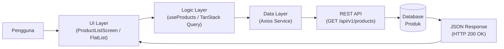

# JAWABAN SOAL 1 – ANALISIS ARSITEKTUR REACT NATIVE DAN STUDI KASUS E-COMMERCE

**Mata Kuliah:** 412573401 Pemrograman Mobile Lanjut (3 SKS)  
**Dosen Pengampu:** Sahrial Ihsani Ishak, S.Kom., M.Kom  
**Mahasiswa:** Marviel David (411231222)  
**Bobot Soal:** 20% (CPMK 1: Memahami arsitektur aplikasi dan komponen lanjutan pada React Native)  

---

## 1. Arsitektur React Native pada Kasus Daftar Produk E-Commerce (Bobot: 20%)

Aplikasi *e-commerce* berbasis React Native yang menampilkan daftar produk, pencarian produk, detail produk, dan keranjang belanja dirancang menggunakan arsitektur tiga lapis (*Three-Tier Layered Architecture*) yang memisahkan tanggung jawab antara **UI Layer**, **Logic Layer**, dan **Data Layer**. Pemisahan ini memastikan antarmuka tetap responsif, kode program modular, serta komunikasi dengan server **REST API** berjalan secara terstruktur.

### 1.1. Peran Tiga Lapisan Arsitektur React Native

1. **UI Layer (*Presentation Layer*)**
   Lapisan antarmuka yang berinteraksi langsung dengan pengguna untuk menampilkan elemen visual dan menangkap aksi pengguna (*touch events* maupun *text input*). Pada studi kasus katalog *e-commerce*, komponen inti React Native yang berperan meliputi:
   * `View`: Kontainer tata letak berbasis *Flexbox* untuk menyusun struktur halaman, kartu produk (*product card*), dan bilah navigasi.
   * `Text`: Menampilkan informasi tekstual seperti nama produk, kategori, harga, persentase diskon, dan *rating*.
   * `Image`: Memuat dan menampilkan foto produk dari URL server (*remote URI*).
   * `TextInput`: Menyediakan kotak pencarian produk (*search bar*) bagi pengguna.
   * `FlatList`: Menampilkan daftar katalog produk secara efisien melalui mekanisme **virtualisasi (*windowing*)**, yaitu hanya merender item produk yang sedang terlihat di area layar (*viewport*) sehingga penggunaan memori tetap ringan meskipun katalog memiliki ratusan hingga ribuan produk.
   * `TouchableOpacity` / `Pressable` & `ActivityIndicator`: Menangani aksi ketukan pada kartu produk/tombol keranjang serta menampilkan indikator pemuatan (*loading spinner*).

2. **Logic Layer (*Business Logic & State Management Layer*)**
   Lapisan pengendali logika bisnis aplikasi yang menjembatani komponen UI dengan sumber data. Lapisan ini diimplementasikan melalui *Custom Hooks* (misalnya `useProducts()`, `useCart()`), pengelola *Client State* (**Context API** atau **Redux Toolkit**), serta pengelola *Server State* (**TanStack Query**). Tugas utamanya mencakup pengaturan siklus pengambilan data (*loading*, *caching*, *error state*), penundaan input pencarian (*debouncing*), pemformatan harga mata uang, serta validasi kuantitas produk sebelum dimasukkan ke keranjang.

3. **Data Layer (*Service & Network Layer*)**
   Lapisan layanan data yang mengabstraksi detail komunikasi jaringan dan penyimpanan lokal perangkat. Lapisan ini menggunakan klien HTTP seperti **Axios** (`productApi.js`, `cartApi.js`) untuk menyusun permintaan HTTP (`GET`, `POST`, `PUT`, `DELETE`), mengatur *base URL*, *timeout*, dan *header* (`Content-Type: application/json`), melakukan serialisasi/deserialisasi data **JSON**, serta mengakses penyimpanan lokal (`AsyncStorage`) untuk menyimpan token autentikasi atau data sementara.

### 1.2. Hubungan Komponen UI dengan Business Logic dan Komunikasi REST API

* **Hubungan Komponen UI dengan Business Logic:** Komponen pada *UI Layer* bersifat deklaratif (`UI = f(state)`). Komponen layar seperti `ProductListScreen` tidak memanggil fungsi jaringan Axios secara langsung di dalam kode tampilan, melainkan memanggil *custom hook* pada *Logic Layer* (contoh: `const { data, isLoading, isError, refetch } = useProducts()`). Ketika pengguna mengetik kata kunci pencarian atau menekan tombol *"Tambah ke Keranjang"*, *UI Layer* meneruskan *event* tersebut ke *Logic Layer*. Setelah *Logic Layer* memperbarui *state*, React secara otomatis melakukan *re-render* pada komponen UI yang relevan.
* **Komunikasi antara Aplikasi dan REST API:** Komunikasi antara aplikasi React Native (melalui *Data Layer*) dan *backend server* berlangsung secara **asinkron (*non-blocking*)** menggunakan protokol HTTP/HTTPS. Permintaan dikirim oleh *Data Layer* menuju *endpoint* REST API, lalu server berinteraksi dengan *database* dan mengembalikan respons berformat **JSON (*JavaScript Object Notation*)**. Karena berjalan secara asinkron di luar *Main UI Thread*, antarmuka aplikasi tidak membeku (*freeze*) saat menunggu respons dari server.

### 1.3. Diagram Alur Pengambilan dan Penampilan Daftar Produk

Berikut adalah diagram alur sederhana proses pengambilan hingga penampilan daftar produk pada aplikasi *e-commerce*:

```text
Pengguna → UI Layer → Logic Layer → Data Layer → REST API → Database → JSON Response → UI Layer
```



**Penjelasan Setiap Tahap Berdasarkan Kasus Aplikasi E-Commerce:**
1. **Pengguna:** Pengguna membuka aplikasi *e-commerce* dan mengakses halaman katalog daftar produk.
2. **UI Layer:** Komponen `ProductListScreen` dipasang (*mount*) ke layar, menampilkan indikator *loading* (`ActivityIndicator` atau *skeleton*) sementara data belum tersedia, dan memicu permintaan data ke *Logic Layer*.
3. **Logic Layer:** *Hook* `useProducts()` memeriksa apakah data katalog produk sudah ada di dalam *cache* memori berdasarkan `queryKey`. Jika belum tersedia atau sudah usang (*stale*), *Logic Layer* memanggil fungsi pengambilan data pada *Data Layer*.
4. **Data Layer:** Modul layanan Axios menyusun dan mengirimkan permintaan HTTP `GET /api/v1/products` secara asinkron melalui jaringan internet menuju server.
5. **REST API:** Server *backend* *e-commerce* menerima permintaan `GET`, memvalidasi parameter kueri (seperti halaman atau kategori produk), dan meneruskan kueri ke basis data.
6. **Database:** Sistem basis data mengeksekusi kueri pembacaan data produk (ID produk, nama, gambar, harga, dan stok) lalu mengembalikan kumpulan baris data ke lapisan REST API.
7. **JSON Response:** Server REST API mengemas data produk ke dalam format teks **JSON** dengan kode status `200 OK` dan mengirimkannya kembali ke aplikasi. *Data Layer* mendeserialisasi JSON menjadi *array* objek JavaScript dan menyimpannya ke *cache* di *Logic Layer*.
8. **UI Layer (Render Akhir):** Perubahan *state* dari `isLoading: true` menjadi `isLoading: false` beserta masuknya data produk memicu *UI Layer* untuk merender daftar kartu produk menggunakan `FlatList` (`Image`, `Text`, dan tombol aksi) ke layar pengguna.

---

## 2. Perbedaan Local State dan Server State serta Peran Context API / Redux (Bobot: 25%)

Ketika pengguna menjelajahi katalog, memilih varian produk, dan menambahkan produk ke keranjang belanja, aplikasi mengelola dua kategori *state* utama, yaitu **Local State** dan **Server State**.

### 2.1. Karakteristik Local State dan Server State pada Kasus E-Commerce

**1. Local State (*Client / UI State*)**
Merupakan *state* lokal yang dibuat, disimpan, dan dikelola sepenuhnya di dalam memori perangkat pengguna untuk kebutuhan interaksi antarmuka. Cakupan *Local State* pada aplikasi *e-commerce* meliputi:
* **Data sementara pada aplikasi:** Data yang hanya dibutuhkan selama pengguna berinteraksi dengan suatu komponen atau halaman aktif.
* **Pilihan ukuran atau warna produk:** Pilihan varian (misalnya ukuran sepatu `42` atau warna `Hitam`) dan jumlah kuantitas awal yang dipilih pengguna pada halaman detail sebelum menekan tombol masukkan ke keranjang.
* **Teks pencarian:** Kata kunci yang sedang diketik pengguna pada komponen `TextInput` pencarian produk.
* **Status modal dan filter:** Status buka/tutup *modal* filter harga, *bottom sheet* detail varian, tab kategori yang sedang aktif, atau visibilitas *alert*.
* **State yang tidak selalu perlu disimpan di server:** Perubahan nilai ini bersifat sementara di sisi *client*, berlangsung secara sinkron/instan, dan tidak perlu dikirim ke database server setiap kali nilainya berubah.

**2. Server State (*Remote State*)**
Merupakan data yang berasal dari server eksternal, disimpan secara permanen di database *backend*, dan diakses oleh aplikasi melalui jaringan. Cakupan *Server State* pada aplikasi *e-commerce* meliputi:
* **Daftar produk:** Katalog lengkap produk beserta foto, deskripsi, dan kategori yang ditampilkan di halaman utama.
* **Harga dan stok produk:** Nilai harga normal, harga diskon, serta jumlah sisa stok barang di gudang secara *real-time*.
* **Data keranjang yang tersimpan di backend:** Daftar item keranjang belanja milik akun pengguna yang telah disinkronkan ke database server agar tetap tersimpan saat pengguna berganti perangkat.
* **Data yang diperoleh melalui REST API:** Seluruh informasi yang diambil secara asinkron melalui permintaan HTTP (`GET`, `POST`, `PUT`, `DELETE`).
* **Data yang dapat berubah di luar kendali aplikasi:** Stok produk atau harga dapat berubah sewaktu-waktu karena dibeli oleh pengguna lain atau diperbarui oleh admin toko di server, sehingga berisiko menjadi usang (*stale*) di sisi aplikasi.

### 2.2. Tabel Perbandingan Local State vs Server State

| Aspek Perbandingan | Local State (*Client State*) | Server State (*Remote State*) |
| :--- | :--- | :--- |
| **Sumber Kebenaran (*Source of Truth*)** | Memori lokal aplikasi pada perangkat pengguna. | Database pada *server backend* yang diakses melalui REST API. |
| **Sifat Pengelolaan & Akses** | Sinkron (*synchronous*) dan instan tanpa jeda jaringan. | Asinkron (*asynchronous*), bergantung pada latensi dan koneksi internet. |
| **Kepemilikan & Kendali Data** | Dikendalikan penuh oleh sesi perangkat pengguna saat itu. | Dibagikan ke banyak pengguna; dapat berubah di luar kendali aplikasi *client*. |
| **Penyimpanan ke Server** | Tidak selalu perlu disimpan di server (bersifat sementara di UI). | Tersimpan secara persisten di database *backend*. |
| **Contoh pada Kasus E-Commerce** | Teks pencarian, pilihan ukuran/warna produk sebelum beli, status buka/tutup modal dan filter. | Daftar produk, harga dan stok produk, serta data keranjang yang tersimpan di *backend*. |
| **Instrumen Pengelola** | `useState`, `useReducer`, **Context API**, **Redux Toolkit**. | **TanStack Query (React Query)**, SWR, RTK Query. |

### 2.3. Peran Context API atau Redux dalam Mengelola State Bersama

Dalam aplikasi *e-commerce*, terdapat data di sisi *client* yang harus diakses secara bersama (*shared state*) oleh banyak halaman dan komponen sekaligus, seperti angka indikator jumlah barang pada ikon keranjang di *header* (`CartBadge`), halaman detail produk (`ProductDetailScreen`), halaman keranjang (`CartScreen`), hingga halaman pembayaran (`CheckoutScreen`).

* **Menghindari *Prop Drilling*:** Tanpa pengelola *state* global, data harus dikirimkan secara berantai melalui *props* melewati banyak komponen perantara. **Context API** maupun **Redux (Redux Toolkit)** menyediakan penyimpanan terpusat (*centralized client store*) sehingga komponen mana pun dapat membaca dan memperbarui *state* secara langsung.
* **Pengelolaan Keranjang Sementara, Autentikasi, dan State Global:** Context API atau Redux sangat efektif digunakan untuk mengelola **keranjang belanja sementara** (termasuk *optimistic UI update* saat pengguna menambahkan item), **status autentikasi pengguna** (data sesi *login* dan token akses), serta **pengaturan global aplikasi** (seperti tema tampilan atau preferensi bahasa).
* **Sinkronisasi dengan Backend:** Meskipun Context API atau Redux mengelola *state* keranjang sementara dan *state* global di sisi *client* agar antarmuka terasa cepat dan responsif, **data server tetap wajib disinkronkan dengan backend** melalui REST API. Sebagai contoh, ketika pengguna menambahkan produk atau mengubah kuantitas di keranjang, *state* di Redux/Context diperbarui untuk memperbarui tampilan layar, lalu aplikasi mengirimkan permintaan ke REST API (`POST` atau `PUT`) agar perubahan keranjang tercatat secara valid di database server dan stok barang diverifikasi.

---

## 3. Integrasi REST API dan Pertukaran Data JSON (Bobot: 30%)

Integrasi antara aplikasi React Native dan *server backend* *e-commerce* menggunakan arsitektur **REST API** dengan empat metode standar HTTP (**GET**, **POST**, **PUT**, dan **DELETE**) serta format pertukaran data **JSON (*JavaScript Object Notation*)**.

> **Catatan Rancangan Endpoint:** Seluruh *endpoint* (`/api/v1/products`, `/api/v1/cart/items`, dan `/api/v1/cart/items/{id}`) yang digunakan pada bagian ini merupakan **contoh rancangan (ilustrasi desain REST API)** untuk studi kasus aplikasi *e-commerce*, bukan *endpoint backend* publik yang telah diverifikasi.

### 3.1. Tabel Endpoint REST API pada Kasus E-Commerce

| HTTP Method | Endpoint (Contoh Rancangan) | Fungsi pada Kasus E-Commerce | Contoh Request Body (JSON) | Contoh Response Body (JSON) | Status HTTP |
| :---: | :--- | :--- | :--- | :--- | :---: |
| **GET** | `/api/v1/products` | Mengambil daftar produk katalog dari server. | Tidak menggunakan *Request Body* (parameter dikirim via *URL query*). | `[{"id": 101, "name": "Sepatu Lari", "price": 350000, "stock": 12}]` | `200 OK` |
| **POST** | `/api/v1/cart/items` | Menambahkan produk baru ke keranjang belanja. | `{"productId": 101, "quantity": 2}` | `{"id": 1, "productId": 101, "quantity": 2}` | `201 Created` |
| **PUT** | `/api/v1/cart/items/1` | Memperbarui jumlah (*quantity*) produk di keranjang. | `{"productId": 101, "quantity": 3}` | `{"id": 1, "productId": 101, "quantity": 3}` | `200 OK` |
| **DELETE** | `/api/v1/cart/items/1` | Menghapus item produk dari keranjang belanja. | Tidak menggunakan *Request Body* (ID item dikirim via *URL path*). | `{"message": "Item keranjang berhasil dihapus", "deletedId": 1}` | `200 OK` |

### 3.2. Penjelasan Fungsi Masing-Masing HTTP Method dan Contoh JSON

#### 1. Method `GET` – Mengambil Daftar Produk
* **Fungsi:** Digunakan secara aman (*safe* dan *idempotent*) untuk mengambil data katalog produk dari server ketika pengguna membuka halaman daftar produk atau melakukan pencarian produk tanpa mengubah data di server.
* **Contoh Request:** `GET /api/v1/products`
* **Contoh Response JSON (`200 OK`):**
```json
[
  {
    "id": 101,
    "name": "Sepatu Lari Pro Runner",
    "price": 350000,
    "stock": 12,
    "image": "https://example.com/images/product-101.jpg"
  },
  {
    "id": 102,
    "name": "Tas Ransel Kasual",
    "price": 225000,
    "stock": 8,
    "image": "https://example.com/images/product-102.jpg"
  }
]
```

#### 2. Method `POST` – Menambahkan Produk ke Keranjang
* **Fungsi:** Digunakan untuk mengirimkan data baru ke server guna membuat entitas item baru di dalam keranjang belanja pengguna ketika tombol *"Tambah ke Keranjang"* ditekan. Objek JavaScript diubah menjadi teks JSON (`JSON.stringify`) dengan *header* `Content-Type: application/json`.
* **Contoh Request (`POST /api/v1/cart/items`):**
```json
{
  "productId": 101,
  "quantity": 2
}
```
* **Contoh Response (`201 Created`):**
```json
{
  "id": 1,
  "productId": 101,
  "quantity": 2
}
```

#### 3. Method `PUT` – Memperbarui Jumlah Produk di Keranjang
* **Fungsi:** Digunakan untuk memperbarui data item keranjang yang sudah ada di server (misalnya pengguna menambah jumlah produk `productId: 101` pada item keranjang ber-ID `1` dari `2` menjadi `3` di halaman keranjang belanja).
* **Contoh Request (`PUT /api/v1/cart/items/1`):**
```json
{
  "productId": 101,
  "quantity": 3
}
```
* **Contoh Response (`200 OK`):**
```json
{
  "id": 1,
  "productId": 101,
  "quantity": 3
}
```

#### 4. Method `DELETE` – Menghapus Produk dari Keranjang
* **Fungsi:** Digunakan untuk menghapus item produk tertentu dari keranjang belanja di server berdasarkan pengenal unik item keranjang (`id: 1`) ketika pengguna menekan tombol hapus.
* **Contoh Request:** `DELETE /api/v1/cart/items/1`
* **Contoh Response (`200 OK`):**
```json
{
  "message": "Produk berhasil dihapus dari keranjang",
  "deletedId": 1,
  "productId": 101
}
```

---

## 4. Server State Management: Caching, Refetching, Loading, dan Error Handling (Bobot: 25%)

Pada penggunaan nyata, pengguna aplikasi *e-commerce* sering menghadapi kondisi jaringan internet yang lambat, tidak stabil, atau terputus sementara. Mekanisme **Server State Management** (seperti menggunakan **TanStack Query**) menjaga agar pengalaman pengguna (*User Experience / UX*) tetap nyaman melalui empat fungsi utama berikut:

### 4.1. Fungsi Masing-Masing Konsep pada Kasus E-Commerce

1. **Caching (Penyimpanan Sementara Data di Memori)**
   * **Cara Kerja:** Menyimpan hasil respons JSON daftar produk dan detail produk di dalam memori aplikasi berdasarkan kunci kueri unik (`queryKey`, misalnya `['products']`) selama durasi waktu segar (`staleTime`) dan waktu simpan memori (`gcTime`).
   * **Manfaat bagi Pengalaman Pengguna:** Saat pengguna membuka halaman daftar produk, memilih salah satu produk untuk melihat detailnya, lalu menekan tombol *Back* kembali ke halaman daftar produk, aplikasi langsung menampilkan katalog dari *cache* secara instan (0 ms) tanpa layar putih atau pemuatan berulang. Jika koneksi tiba-tiba terputus, produk yang sudah pernah dimuat tetap dapat dilihat dari *cache*.

2. **Refetching (Penyegaran dan Sinkronisasi Data Otomatis)**
   * **Cara Kerja:** Mengambil ulang data dari server secara otomatis di latar belakang (*background refetch*) menggunakan pola *Stale-While-Revalidate* ketika data di *cache* sudah melewati `staleTime`, ketika pengguna menarik layar ke bawah (*pull-to-refresh*), atau ketika koneksi internet yang sempat terputus kembali terhubung (`refetchOnReconnect`).
   * **Manfaat bagi Pengalaman Pengguna:** Menjamin informasi krusial seperti perubahan harga diskon dan sisa stok produk di gudang selalu mutakhir sesuai kondisi server tanpa menghentikan aktivitas pengguna di layar.

3. **Loading (Indikator Status Pemuatan Data)**
   * **Cara Kerja:** Menyediakan penanda status pemuatan data (`isLoading` untuk pemuatan awal saat *cache* masih kosong, dan `isRefetching` untuk pembaruan di latar belakang) sehingga antarmuka dapat menampilkan `ActivityIndicator` atau *Skeleton Loader*.
   * **Manfaat bagi Pengalaman Pengguna:** Saat koneksi internet lambat, kehadiran *skeleton* atau *spinner* memberikan kepastian visual bahwa aplikasi sedang memproses permintaan data ke server, bukan mengalami *hang* atau *freeze*.

4. **Error Handling (Penanganan Kegagalan Jaringan & Pemulihan)**
   * **Cara Kerja:** Menangkap kegagalan komunikasi API (seperti *timeout*, internet mati, atau *server error* `500`), melakukan percobaan ulang otomatis terbatas (*automatic retry*), dan mengalihkan tampilan ke komponen kesalahan (`ErrorState`) yang dilengkapi pesan informatif serta tombol **"Coba Lagi" (*Retry*)** untuk memanggil fungsi `refetch()`.
   * **Manfaat bagi Pengalaman Pengguna:** Mencegah aplikasi mengalami *force close* (*crash*) atau menampilkan layar kosong yang membingungkan saat sinyal hilang, serta memudahkan pengguna memuat ulang katalog produk begitu jaringan kembali tersedia.

### 4.2. Kenyamanan Aplikasi pada Berbagai Kondisi Koneksi

| Kondisi Jaringan | Perilaku Aplikasi E-Commerce dengan Server State Management |
| :--- | :--- |
| **Koneksi Lambat (*Slow Network*)** | Saat pembukaan awal, komponen **Loading** (*skeleton/spinner*) tampil menjaga layar tetap komunikatif. Untuk halaman yang sudah pernah dibuka, **Caching** menyajikan daftar produk secara instan sementara pembaruan berjalan di latar belakang tanpa menghambat navigasi pengguna. |
| **Koneksi Terputus (*Offline / Disconnected*)** | Produk yang sebelumnya telah tersimpan di **Cache** tetap dapat dilihat oleh pengguna. Jika pengguna mengakses data baru yang belum ada di *cache*, mekanisme **Error Handling** menangkap kegagalan jaringan secara aman tanpa *crash*, menampilkan informasi gangguan jaringan, dan menyediakan tombol **Retry**. |
| **Koneksi Kembali Tersedia (*Reconnected*)** | Melalui fitur **Refetching** otomatis (`refetchOnReconnect`) atau ketika pengguna menekan tombol **Retry**, aplikasi segera mengambil ulang data produk terbaru dari REST API, memperbarui *cache*, dan merender kembali katalog produk secara normal. |
