# DOKUMENTASI TEKNIS APLIKASI RECIPEKU – INDONESIAN RECIPE EXPLORER

**Mata Kuliah:** Pemrograman Mobile Lanjut (412573401)  
**Soal:** Soal 2 (Bobot 35% – CPMK 2)  

---

## 1. Arsitektur Aplikasi RecipeKu

Aplikasi **RecipeKu** dirancang menggunakan pemisahan lapisan (*Clean Layered Architecture*) agar pengelolaan *Server State* dengan **TanStack Query** dan pemanggilan jaringan dengan **Axios** terpisah secara rapi dari komponen presentasi React Native.

```mermaid
flowchart LR
    subgraph UI ["Presentation Layer (src/screens & src/components)"]
        H["HomeScreen.js"]
        S["SearchScreen.js"]
        I["IngredientsScreen.js"]
        D["DetailScreen.js"]
        C["CookingInstructionsScreen.js"]
        Comp["Reusable Components:<br/>RecipeCard, SearchBar, Loading, ErrorState, EmptyState"]
    end

    subgraph HOOKS ["Server State Layer (src/hooks/useRecipes.js)"]
        QC["QueryClientProvider<br/>(staleTime: 5m, gcTime: 30m)"]
        UL["useRecipesList(tag)"]
        US["useSearchRecipes(debouncedQuery)"]
        UD["useRecipeDetail(recipeId)"]
        UIng["useRecipesByIngredients(chips, keyword)"]
    end

    subgraph API ["Data / Service Layer (src/api/recipeApi.js)"]
        AX["Axios Client Instance<br/>(baseURL: https://dummyjson.com)"]
    end

    subgraph SERVER ["External REST API"]
        DJ[("DummyJSON Recipes API")]
    end

    UI --> HOOKS
    HOOKS --> API
    AX -->|"HTTP GET (JSON)"| DJ
```

---

## 2. Daftar Endpoint REST API yang Digunakan

Seluruh endpoint mengacu secara ketat pada dokumentasi resmi `https://dummyjson.com/docs/recipes`:

| No | Fungsi Fitur | HTTP Method & Endpoint | Hook TanStack Query | Query Key |
| :-: | :--- | :--- | :--- | :--- |
| 1 | Mengambil katalog resep | `GET https://dummyjson.com/recipes?limit=50&skip=0` | `useRecipesList('All')` | `['recipes', 'list', 'All']` |
| 2 | Mencari resep berdasarkan nama | `GET https://dummyjson.com/recipes/search?q={query}` | `useSearchRecipes(query)` | `['recipes', 'search', query]` |
| 3 | Mengambil detail resep berdasarkan ID | `GET https://dummyjson.com/recipes/{id}` | `useRecipeDetail(id)` | `['recipes', 'detail', id]` |
| 4 | Mengambil daftar tag kuliner | `GET https://dummyjson.com/recipes/tags` | `useRecipeTags()` | `['recipes', 'tags']` |
| 5 | Filter resep berdasarkan tag | `GET https://dummyjson.com/recipes/tag/{tag}` | `useRecipesList(tag)` | `['recipes', 'list', tag]` |

---

## 3. Implementasi TanStack Query (Server State Management)

Di dalam `App.js` dan `src/hooks/useRecipes.js`, TanStack Query dikonfigurasi dengan parameter berikut:
1. **`QueryClient` & `QueryClientProvider`:** Membungkus seluruh navigasi aplikasi di `App.js` untuk menyediakan *cache store* terpusat.
2. **`staleTime: 300000` (5 Menit):** Ketika daftar resep atau detail resep telah berhasil diambil, data ditandai sebagai *fresh* selama 5 menit. Saat pengguna membuka detail resep lalu kembali ke halaman *Home*, atau membuka kembali resep yang sama, data disajikan secara instan dari *memory cache* tanpa memicu pemanggilan jaringan berulang.
3. **`gcTime: 1800000` (30 Menit):** Menjaga data yang sedang tidak aktif (*inactive queries*) tetap berada di dalam memori selama 30 menit sebelum dihapus oleh *Garbage Collector*.
4. **`enabled` (Conditional Fetching):**
   * Pada `useSearchRecipes(debouncedQuery)`, properti `enabled: normalizedQuery.length > 0` mencegah pemanggilan API saat kotak pencarian masih kosong.
   * Pada `useRecipeDetail(recipeId)`, properti `enabled: Boolean(recipeId)` memastikan endpoint `/recipes/{id}` hanya dipanggil jika parameter `recipeId` valid.
5. **Initial Cache Hydration (`initialData`):** Pada `useRecipeDetail`, sebelum mengambil `/recipes/{id}`, hook memeriksa apakah objek resep tersebut sudah ada di dalam *cache* `['recipes', 'list', 'All']`. Jika ada, halaman detail langsung tampil dalam 0 milidetik tanpa layar *loading*.

---

## 4. Penjelasan Teknis Pencarian Berdasarkan Bahan Makanan (*Search by Ingredients*)

Sesuai ketentuan Soal 2:
> *"Implementasikan pencarian berdasarkan bahan makanan jika API mendukungnya. Gunakan endpoint atau mekanisme pencarian yang benar-benar tersedia. Jika API tidak menyediakan pencarian langsung berdasarkan bahan, gunakan filtering terhadap data resep yang tersedia dan jelaskan keterbatasannya. Jangan mengarang endpoint API."*

**Analisis Keterbatasan Endpoint DummyJSON:**
* Endpoint `GET https://dummyjson.com/recipes/search?q={query}` pada server DummyJSON hanya melakukan pencocokan terhadap atribut **`name`** (nama hidangan) dan **tidak** memindai isi array `ingredients`.
* Selain itu, DummyJSON tidak memiliki endpoint seperti `/recipes/ingredients` atau `/recipes?ingredient=...`.

**Solusi yang Diimplementasikan (`useRecipesByIngredients`):**
* Aplikasi memanfaatkan data katalog resep lengkap dari endpoint resmi `GET https://dummyjson.com/recipes?limit=50` yang telah di-*cache* oleh TanStack Query.
* Fungsi `useMemo` di dalam `useRecipesByIngredients` mengekstrak daftar bahan populer secara dinamis dan memfilter resep yang memiliki kecocokan pada array `recipe.ingredients` (mendukung pemilihan *multi-chip* maupun input teks beberapa bahan yang dipisahkan tanda koma, serta menampilkan daftar bahan yang cocok pada setiap kartu hasil pencarian).

