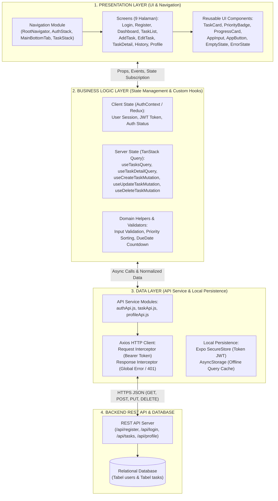

# PERANCANGAN ARSITEKTUR REACT NATIVE – DAILYTASK

Dokumen ini menjelaskan arsitektur aplikasi **DailyTask** berbasis React Native yang mencakup **Presentation Layer**, **Business Logic Layer**, **Data Layer**, **Navigation**, **State Management**, **API Service**, dan **Database**, beserta struktur folder proyek yang direkomendasikan.

---

## 1. Diagram Arsitektur Aplikasi DailyTask



---

## 2. Penjelasan Komponen Arsitektur

1. **Presentation Layer:** Mengatur tampilan visual (9 halaman aplikasi), komponen *reusable* (`TaskCard`, `PriorityBadge`, `DailyProgressCard`), dan perpindahan antarhalaman menggunakan React Navigation (`AuthStack`, `BottomTab`, dan `NativeStack`).
2. **Business Logic Layer:** Mengoordinasikan logika aplikasi melalui pemisahan **Client State** (`AuthContext` untuk sesi login pengguna) dan **Server State** (**TanStack Query** untuk pengambilan daftar tugas, *caching*, serta mutasi tambah/ubah/hapus/selesai tugas dengan *automatic cache invalidation*).
3. **Data Layer:** Bertanggung jawab atas komunikasi HTTP melalui **Axios** (`authApi.js`, `taskApi.js`, `profileApi.js`) dengan penyisipan otomatis *header* `Authorization: Bearer <token>` dari `Expo SecureStore`.
4. **Backend REST API & Database:** Menyediakan layanan *endpoint* autentikasi, manajemen tugas, dan profil yang terhubung ke basis data relasional (`users` dan `tasks`).

---

## 3. Struktur Folder Proyek React Native yang Direkomendasikan

```text
DailyTask/
├── src/
│   ├── api/
│   │   ├── axiosClient.js
│   │   ├── authApi.js
│   │   ├── taskApi.js
│   │   └── profileApi.js
│   ├── components/
│   │   ├── common/
│   │   │   ├── AppButton.js
│   │   │   ├── AppInput.js
│   │   │   ├── LoadingOverlay.js
│   │   │   ├── ErrorState.js
│   │   │   └── EmptyState.js
│   │   └── tasks/
│   │       ├── TaskCard.js
│   │       ├── PriorityBadge.js
│   │       ├── StatusBadge.js
│   │       └── DailyProgressCard.js
│   ├── context/
│   │   └── AuthContext.js
│   ├── hooks/
│   │   ├── useAuth.js
│   │   ├── useTasks.js
│   │   └── useDebounce.js
│   ├── navigation/
│   │   ├── RootNavigator.js
│   │   ├── AuthNavigator.js
│   │   └── MainNavigator.js
│   ├── screens/
│   │   ├── LoginScreen.js
│   │   ├── RegisterScreen.js
│   │   ├── DashboardScreen.js
│   │   ├── TaskListScreen.js
│   │   ├── AddTaskScreen.js
│   │   ├── EditTaskScreen.js
│   │   ├── TaskDetailScreen.js
│   │   ├── HistoryScreen.js
│   │   └── ProfileScreen.js
│   ├── constants/
│   │   ├── colors.js
│   │   └── priorities.js
│   └── utils/
│       ├── dateFormatter.js
│       └── storage.js
├── App.js
├── package.json
└── README.md
```

