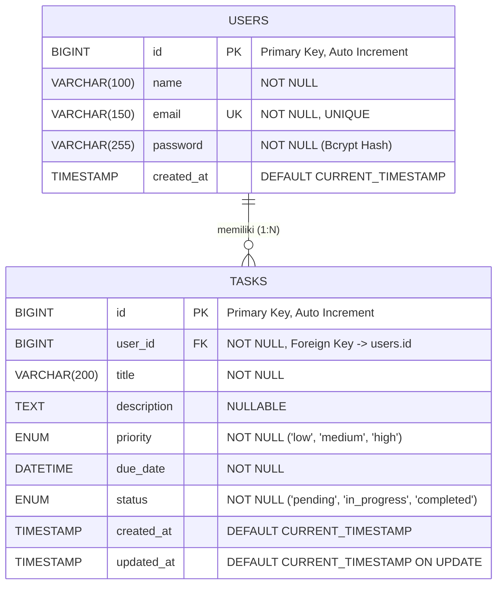

# PERANCANGAN DATABASE & ENTITY RELATIONSHIP DIAGRAM (ERD) – DAILYTASK

Dokumen ini memuat spesifikasi rancangan basis data relasional untuk aplikasi **DailyTask**, mencakup struktur tabel **`users`** dan **`tasks`**, tipe data, *Primary Key*, *Foreign Key*, relasi antarentitas, diagram ERD, serta skrip DDL SQL.

---

## 1. Entity Relationship Diagram (ERD)

---

## 2. Penjelasan Relasi Antarentitas
* **Kardinalitas Relasi:** **One-to-Many (`1 : N`)** dari tabel `users` ke tabel `tasks`.
* **Aturan Bisnis & Integritas Referensial:**
  1. Satu pengguna terdaftar pada tabel `users` (`users.id`) dapat membuat dan memiliki nol, satu, atau banyak baris tugas pada tabel `tasks` (`tasks.user_id`).
  2. Setiap baris tugas pada tabel `tasks` wajib terhubung secara eksklusif ke satu pemilik akun yang valid pada tabel `users` melalui kunci tamu `FOREIGN KEY (user_id) REFERENCES users(id) ON DELETE CASCADE`.
  3. Kebijakan `ON DELETE CASCADE` memastikan apabila akun pengguna dihapus, seluruh tugas milik pengguna tersebut juga dibersihkan secara otomatis tanpa meninggalkan *orphan records*.

---

## 3. Struktur Detail Tabel

### A. Tabel `users`
| Kolom | Tipe Data | Constraint | Keterangan |
| :--- | :--- | :--- | :--- |
| `id` | `BIGINT UNSIGNED` | **PRIMARY KEY**, `AUTO_INCREMENT` | ID unik pengguna |
| `name` | `VARCHAR(100)` | `NOT NULL` | Nama lengkap pengguna |
| `email` | `VARCHAR(150)` | `NOT NULL`, **UNIQUE** | Alamat email untuk login |
| `password` | `VARCHAR(255)` | `NOT NULL` | Hash kata sandi (`bcrypt`) |
| `created_at` | `TIMESTAMP` | `NOT NULL`, `DEFAULT CURRENT_TIMESTAMP` | Waktu pendaftaran akun |

### B. Tabel `tasks`
| Kolom | Tipe Data | Constraint | Keterangan |
| :--- | :--- | :--- | :--- |
| `id` | `BIGINT UNSIGNED` | **PRIMARY KEY**, `AUTO_INCREMENT` | ID unik tugas |
| `user_id` | `BIGINT UNSIGNED` | **FOREIGN KEY** (`users.id`), `NOT NULL` | ID pengguna pemilik tugas |
| `title` | `VARCHAR(200)` | `NOT NULL` | Judul tugas harian |
| `description` | `TEXT` | `NULLABLE` | Rincian deskripsi tugas |
| `priority` | `ENUM('low','medium','high')` | `NOT NULL`, `DEFAULT 'medium'` | Skala prioritas tugas |
| `due_date` | `DATETIME` | `NOT NULL` | Batas waktu penyelesaian tugas |
| `status` | `ENUM('pending','in_progress','completed')` | `NOT NULL`, `DEFAULT 'pending'` | Status pengerjaan tugas |
| `created_at` | `TIMESTAMP` | `NOT NULL`, `DEFAULT CURRENT_TIMESTAMP` | Waktu tugas dibuat |
| `updated_at` | `TIMESTAMP` | `NOT NULL`, `DEFAULT CURRENT_TIMESTAMP ON UPDATE CURRENT_TIMESTAMP` | Waktu terakhir tugas diperbarui |

