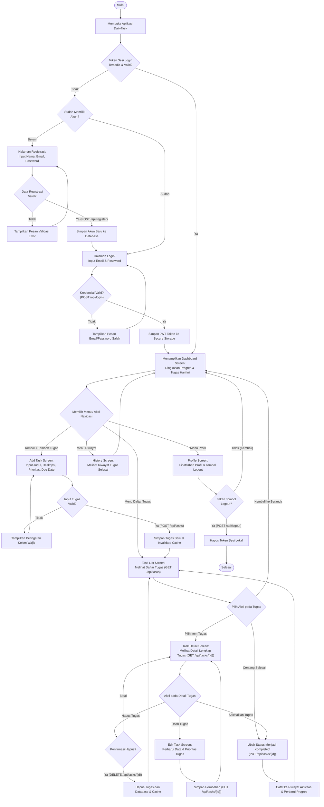
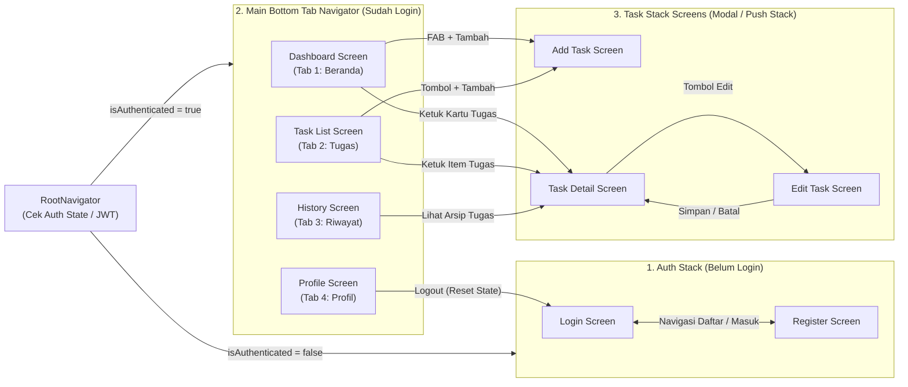
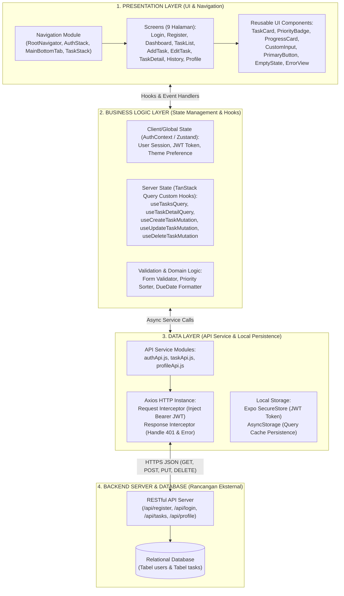
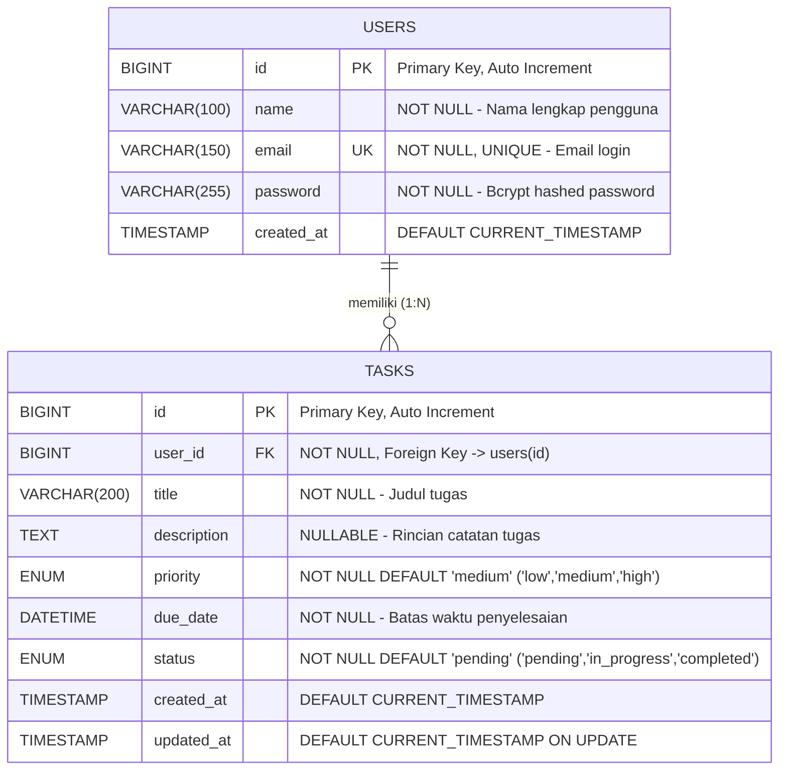

# DOKUMEN RANCANGAN PROYEK APLIKASI MOBILE: DAILYTASK – APLIKASI MANAJEMEN AKTIVITAS HARIAN

**Mata Kuliah:** Pemrograman Mobile Lanjut (412573401)  
**Soal:** Soal 3 (Bobot Penilaian: 45% – CPMK 5)  
**Model Pembelajaran:** Project Based Learning  
**Judul Proyek:** **DailyTask – Aplikasi Manajemen Aktivitas Harian Berbasis React Native**  

---

## BAGIAN A: IDENTIFIKASI MASALAH DAN SOLUSI (Bobot: 15%)

### 1. Latar Belakang
Dalam era digital dengan mobilitas tinggi, individu modern—baik mahasiswa yang menjalani perkuliahan sekaligus organisasi, pekerja profesional dengan tenggat proyek berlapis, maupun masyarakat umum yang mengelola urusan rumah tangga—sering kali dihadapkan pada beban informasi dan tanggung jawab harian yang padat. Mengandalkan ingatan semata atau catatan kertas konvensional sering kali menyebabkan tugas terlewat (*missed deadlines*), tumpang-tindih jadwal, serta ketidakmampuan membedakan mana aktivitas yang bersifat mendesak (*urgent*) dan mana yang dapat ditunda.

Perangkat *smartphone* merupakan benda yang selalu dibawa oleh pengguna sepanjang hari. Oleh karena itu, dibutuhkan sebuah solusi aplikasi mobile lintas platform (*cross-platform*) berbasis **React Native** bernama **DailyTask** yang dirancang khusus untuk membantu pengguna merencanakan jadwal, mencatat daftar tugas, menetapkan skala prioritas, serta memantau produktivitas dan riwayat penyelesaian aktivitas harian secara terstruktur.

### 2. Identifikasi Masalah
Berdasarkan observasi terhadap pola manajemen waktu pengguna sehari-hari, ditemukan lima permasalahan utama:
1. **Pencatatan Tidak Terpusat:** Pengguna mencatat tugas di berbagai media yang terpisah (kertas tempel, aplikasi pesan instan, atau ingatan), sehingga sulit dilacak kembali saat dibutuhkan.
2. **Kesulitan Menentukan Prioritas:** Pengguna kesulitan memilah tugas mana yang harus dikerjakan terlebih dahulu ketika banyak tenggat waktu (*deadline*) jatuh pada minggu yang sama.
3. **Kurangnya Visibilitas Progres Harian:** Tidak adanya ringkasan visual (*dashboard*) yang menampilkan berapa tugas yang sudah selesai (*completed*), sedang dikerjakan (*in progress*), atau masih tertunda (*pending*) pada hari tersebut.
4. **Risiko Kehilangan Data Akibat Tidak Tersinkronisasi:** Catatan lokal pada perangkat sering hilang ketika pengguna berganti ponsel atau aplikasi terhapus, karena tidak terhubung ke basis data berbasis akun di server.
5. **Tidak Adanya Evaluasi Riwayat Aktivitas:** Pengguna tidak memiliki rekam jejak (*history log*) atas tugas-tugas yang telah diselesaikan pada hari atau minggu sebelumnya sebagai bahan evaluasi produktivitas.

### 3. Solusi yang Ditawarkan
**DailyTask** hadir sebagai aplikasi manajemen aktivitas harian berbasis **React Native** yang terintegrasi dengan layanan *backend* REST API dan penyimpanan lokal (*offline-first cache*). Solusi yang ditawarkan meliputi:
* Sistem manajemen akun terautentikasi (**JWT Authentication**) agar seluruh data tugas pengguna tersimpan aman di basis data server dan dapat diakses kembali kapan saja.
* **Dashboard Produktivitas Harian** yang menyajikan metrik ringkas jumlah tugas hari ini, persentase penyelesaian, dan daftar tugas berprioritas tinggi.
* **Klasifikasi Skala Prioritas Tiga Tingkat** (*High / Tinggi*, *Medium / Sedang*, *Low / Rendah*) dengan kode warna visual yang tegas.
* **Pelacakan Status Siklus Hidup Tugas** (*Pending*, *In Progress*, *Completed*) serta pencatatan **Riwayat Aktivitas (*Activity History*)** secara otomatis.

### 4. Tujuan Aplikasi
1. Menyediakan sarana pencatatan, pengubahan, dan penghapusan tugas harian (*CRUD Operations*) yang cepat, intuitif, dan responsif pada perangkat mobile.
2. Membantu pengguna mengorganisasikan beban kerja harian berdasarkan tenggat waktu (`due_date`) dan tingkat prioritas (`priority`).
3. Menyajikan informasi progres penyelesaian tugas secara *real-time* melalui halaman *Dashboard* dan *History*.
4. Menerapkan arsitektur aplikasi React Native yang modular dan skalabel dengan memisahkan *Presentation Layer*, *Business Logic Layer*, dan *Data Layer*.

### 5. Manfaat Aplikasi
* **Meningkatkan Produktivitas dan Disiplin Waktu:** Pengguna dapat fokus menyelesaikan tugas berprioritas tinggi tepat sebelum tenggat waktu berakhir.
* **Mengurangi Beban Kognitif (*Mental Load*):** Seluruh jadwal dan rincian tugas terdokumentasi secara rapi di dalam satu aplikasi.
* **Kemudahan Evaluasi Diri:** Melalui fitur *Riwayat Aktivitas*, pengguna dapat meninjau kembali capaian produktivitas harian maupun mingguan mereka.

### 6. Target Pengguna
| Segmen Pengguna | Karakteristik & Kebutuhan Utama | Contoh Penggunaan pada DailyTask |
| :--- | :--- | :--- |
| **1. Mahasiswa** | Memiliki jadwal kuliah, tugas individu/kelompok, praktikum, dan kegiatan organisasi kampus. | Mencatat tenggat pengumpulan UTS/UAS, menetapkan prioritas *High* pada tugas yang dikumpulkan besok, dan memantau progres belajar. |
| **2. Pekerja Profesional** | Mengelola rapat harian, target proyek (*deliverables*), laporan klien, dan *follow-up* pekerjaan. | Menyusun *to-do list* kerja harian di pagi hari, memperbarui status tugas menjadi *Completed*, dan meninjau riwayat kerja mingguan. |
| **3. Masyarakat Umum** | Mengatur aktivitas domestik, daftar belanja bulanan, jadwal pembayaran tagihan, dan kegiatan keluarga. | Mencatat pengingat bayar listrik/air, jadwal olahraga, serta rutinitas harian dengan antarmuka yang mudah dipahami. |

---

## BAGIAN B: ANALISIS KEBUTUHAN APLIKASI (Bobot: 15%)

### 1. Empat Fitur Utama Aplikasi (*Core Features*)
Sesuai instruksi soal yang mensyaratkan penentuan minimal empat fitur utama, **DailyTask** memiliki **6 Fitur Utama** berikut:
1. **Autentikasi & Manajemen Profil Pengguna (*User Auth & Profile*):** Registrasi akun baru, *login* berbasis token JWT, pengelolaan profil, dan *logout* aman.
2. **Dashboard Ringkasan Produktivitas (*Smart Daily Dashboard*):** Visualisasi kartu progres harian (persentase tugas selesai), statistik jumlah tugas per status, dan daftar tugas mendesak hari ini.
3. **Manajemen Siklus Hidup Tugas (*Full CRUD Task Management*):** Penambahan tugas baru, penampilan daftar tugas dengan filter/pencarian, lihat detail, pengubahan isi tugas, hingga penghapusan tugas.
4. **Pengaturan Skala Prioritas & Tenggat Waktu (*Priority & Due Date Engine*):** Penetapan level prioritas (*High*, *Medium*, *Low*) dengan indikator warna serta pengelompokan tugas berdasarkan tanggal jatuh tempo.
5. **Penyelesaian Tugas Satu Ketukan (*One-Tap Task Completion*):** Perubahan status tugas menjadi *Completed* secara instan dari daftar tugas maupun halaman detail.
6. **Riwayat Aktivitas & Arsip Tugas (*Activity & Completion History*):** Pencatatan kronologis seluruh tugas yang telah diselesaikan beserta waktu penyelesaiannya.

### 2. Analisis Kebutuhan Fungsional (*Functional Requirements*)
Tabel berikut merinci **11 Kebutuhan Fungsional** aplikasi **DailyTask**:

| Kode | Nama Kebutuhan Fungsional | Aktor | Deskripsi Fungsionalitas Sistem | Layar Terkait |
| :---: | :--- | :---: | :--- | :--- |
| **FR-01** | **Registrasi Akun** | Pengguna | Sistem menyediakan formulir pendaftaran berisi nama lengkap, alamat email, dan kata sandi, memvalidasi input, serta menyimpan akun pengguna baru ke database. | `RegisterScreen` |
| **FR-02** | **Login Pengguna** | Pengguna | Sistem memverifikasi kredensial email dan kata sandi pengguna melalui REST API dan menerbitkan token autentikasi (JWT) untuk membuka akses aplikasi. | `LoginScreen` |
| **FR-03** | **Logout Pengguna** | Pengguna | Sistem menghapus sesi aktif dan token JWT dari penyimpanan lokal perangkat serta mengarahkan pengguna kembali ke halaman Login. | `ProfileScreen` |
| **FR-04** | **Melihat Dashboard** | Pengguna | Sistem menampilkan sapaan pengguna, ringkasan metrik tugas (Total, *Pending*, *Completed*), bar persentase progres harian, dan daftar tugas prioritas hari ini. | `DashboardScreen` |
| **FR-05** | **Menambahkan Tugas** | Pengguna | Sistem menyediakan formulir input judul tugas, deskripsi, pilihan prioritas (*Low*, *Medium*, *High*), dan tanggal tenggat (`due_date`) untuk disimpan sebagai tugas baru. | `AddTaskScreen` |
| **FR-06** | **Mengubah Tugas** | Pengguna | Sistem memungkinkan pengguna memperbarui judul, deskripsi, tingkat prioritas, tanggal tenggat, maupun status pada tugas yang sudah dibuat sebelumnya. | `EditTaskScreen` |
| **FR-07** | **Menghapus Tugas** | Pengguna | Sistem menampilkan dialog konfirmasi dan menghapus data tugas yang dipilih secara permanen dari server maupun daftar tampilan. | `TaskDetailScreen`, `TaskListScreen` |
| **FR-08** | **Melihat Detail Tugas** | Pengguna | Sistem menampilkan informasi lengkap suatu tugas yang mencakup judul, deskripsi penuh, badge prioritas, status saat ini, tanggal tenggat, serta waktu pembuatan/pembaruan. | `TaskDetailScreen` |
| **FR-09** | **Mengatur Prioritas Tugas** | Pengguna | Sistem menyediakan pemilih prioritas (*Low / Rendah*, *Medium / Sedang*, *High / Tinggi*) dan memfilter atau mengurutkan daftar tugas berdasarkan tingkat urgensi tersebut. | `AddTaskScreen`, `EditTaskScreen`, `TaskListScreen` |
| **FR-10** | **Mengubah Status Tugas Menjadi Selesai** | Pengguna | Sistem memungkinkan pengguna menandai tugas sebagai selesai (`status = 'completed'`), memperbarui waktu penyelesaian, dan memperbarui progres di Dashboard secara langsung. | `TaskListScreen`, `TaskDetailScreen` |
| **FR-11** | **Melihat Riwayat Aktivitas** | Pengguna | Sistem menampilkan daftar riwayat tugas yang telah diselesaikan berdasarkan urutan waktu terbaru lengkap dengan filter rentang tanggal. | `HistoryScreen` |

### 3. Analisis Kebutuhan Nonfungsional (*Non-Functional Requirements*)
Tabel berikut merinci **6 Kebutuhan Nonfungsional** aplikasi **DailyTask**:

| Kode | Aspek Nonfungsional | Spesifikasi & Indikator Keberhasilan | Implementasi Teknis pada React Native |
| :---: | :--- | :--- | :--- |
| **NFR-01** | **Kemudahan Penggunaan (*Usability*)** | Antarmuka intuitif, konsisten, dan mengikuti prinsip *Human Interface / Material Design*. Pengguna baru dapat menambah dan menyelesaikan tugas pertama dalam waktu < 30 detik tanpa panduan. | Hierarki tipografi jelas, kode warna prioritas standar (Merah = *High*, Kuning = *Medium*, Hijau = *Low*), serta *Bottom Tab Navigation* 4 menu utama. |
| **NFR-02** | **Keamanan (*Security*)** | Seluruh komunikasi jaringan terenkripsi dan kata sandi tidak pernah disimpan dalam bentuk teks biasa (*plain text*). Akses endpoint tugas wajib terautentikasi. | Komunikasi melalui HTTPS, *password hashing* dengan `bcrypt` di *backend*, autentikasi *Bearer Token JWT*, serta penyimpanan token di `Expo SecureStore`. |
| **NFR-03** | **Performa (*Performance*)** | Waktu muat halaman awal < 1,5 detik pada jaringan 4G, dan pergeseran daftar tugas (*scrolling*) berjalan mulus pada 60 FPS tanpa jeda visual. | Penggunaan `FlatList` dengan *windowing*, *caching* Server State menggunakan **TanStack Query**, dan *memoization* komponen (`React.memo`, `useCallback`). |
| **NFR-04** | **Responsivitas (*Responsiveness*)** | Tata letak antarmuka beradaptasi secara proporsional pada berbagai ukuran layar *smartphone* Android dan iOS (mulai dari layar 5,4 inci hingga 6,8 inci). | Tata letak berbasis Flexbox, `SafeAreaView` (`react-native-safe-area-context`), `Dimensions` / `useWindowDimensions`, dan `KeyboardAvoidingView`. |
| **NFR-05** | **Keandalan (*Reliability*)** | Aplikasi tidak mengalami *force close / crash* ketika koneksi internet terputus. Pengguna tetap dapat melihat daftar tugas yang sudah di-*cache*. | *Error Boundary*, penanganan eksepsi jaringan pada interceptor Axios, *offline cache persistence*, serta komponen *ErrorState* dengan tombol *Retry*. |
| **NFR-06** | **Pemeliharaan Aplikasi (*Maintainability*)** | Kode sumber modular, mudah dibaca, dan mudah dikembangkan oleh tim secara kolaboratif tanpa menimbulkan konflik ketergantungan. | Arsitektur berlapis (*Presentation*, *Logic/Hooks*, *Data/API*), komponen *reusable*, penamaan variabel konsisten, dan dokumentasi endpoint yang baku. |

---

## BAGIAN C: PERANCANGAN FLOWCHART / ACTIVITY DIAGRAM (Bobot: 10%)

Diagram alir berikut menggambarkan keseluruhan siklus penggunaan aplikasi **DailyTask** mulai dari pengguna membuka aplikasi, proses autentikasi (Login dan Registrasi), interaksi di halaman Dashboard, pengelolaan tugas (Lihat, Tambah, Ubah, Hapus, Selesaikan Tugas), melihat riwayat aktivitas, hingga Logout.



*(File terpisah untuk diagram alir juga tersedia pada direktori [`flowchart/Flowchart_DailyTask.md`](file:///c:/Users/User/OneDrive/Documents/UTS%20Mobile/UTS_PEMROGRAMAN_MOBILE_LANJUT/03_SOAL_3_DAILYTASK/flowchart/Flowchart_DailyTask.md) dan [`flowchart/flowchart_dailytask.svg`](file:///c:/Users/User/OneDrive/Documents/UTS%20Mobile/UTS_PEMROGRAMAN_MOBILE_LANJUT/03_SOAL_3_DAILYTASK/flowchart/flowchart_dailytask.svg)).*

---

## BAGIAN D: PERANCANGAN NAVIGASI ANTARHALAMAN (Bobot: 10%)

### 1. Arsitektur Navigasi React Navigation
Navigasi aplikasi **DailyTask** dirancang menggunakan pola **Root Conditional Navigator** yang memisahkan alur pengguna sebelum *login* (`AuthStackNavigator`) dan sesudah *login* (`MainAppNavigator` yang mengombinasikan `BottomTabNavigator` dengan `NativeStackNavigator`).



### 2. Penjelasan Fungsi Masing-Masing Halaman dan Hubungan Navigasinya

| No | Nama Halaman (*Screen*) | Jenis Navigator | Fungsi Utama Halaman | Hubungan Navigasi Masuk & Keluar |
| :-: | :--- | :--- | :--- | :--- |
| 1 | **Login Screen** | `AuthStack` | Halaman masuk bagi pengguna terdaftar menggunakan email dan kata sandi. | • **Ke Register Screen:** jika pengguna menekan tautan *"Belum punya akun? Daftar"*.<br/>• **Ke Dashboard Screen:** otomatis berpindah ke `MainTabs` setelah login berhasil. |
| 2 | **Register Screen** | `AuthStack` | Halaman pendaftaran akun baru dengan input nama lengkap, email, password, dan konfirmasi password. | • **Dari/Ke Login Screen:** kembali ke halaman Login setelah registrasi sukses atau menekan tombol *"Sudah punya akun? Masuk"*. |
| 3 | **Dashboard Screen** | `BottomTab` (Tab 1) | Halaman utama (*Home*) yang menampilkan ringkasan statistik harian, grafik progres penyelesaian, dan tugas prioritas hari ini. | • **Ke Add Task Screen:** melalui tombol mengambang (*Floating Action Button* `+`).<br/>• **Ke Task Detail Screen:** saat menekan salah satu kartu tugas hari ini.<br/>• **Ke Task List / History / Profile:** melalui bilah navigasi bawah (*Bottom Tab*). |
| 4 | **Task List Screen** | `BottomTab` (Tab 2) | Menampilkan seluruh daftar tugas pengguna dengan fitur pencarian, filter status (*All*, *Pending*, *In Progress*, *Completed*), dan filter prioritas (*High*, *Medium*, *Low*). | • **Ke Add Task Screen:** menekan tombol `+ Tambah`.<br/>• **Ke Task Detail Screen:** menekan salah satu baris tugas pada `FlatList`. |
| 5 | **Add Task Screen** | `MainStack` | Formulir pembuatan tugas baru (input judul, deskripsi, pemilih prioritas, pemilih tanggal tenggat `due_date`, dan tombol Simpan). | • **Dari:** `DashboardScreen` atau `TaskListScreen`.<br/>• **Keluar:** kembali (`goBack()`) ke layar pemanggil setelah tugas berhasil disimpan (`POST /api/tasks`). |
| 6 | **Edit Task Screen** | `MainStack` | Formulir pengubahan data tugas yang sudah ada, terisi otomatis (*pre-filled*) dengan data tugas sebelumnya. | • **Dari:** `TaskDetailScreen` (membawa parameter `taskId` dan objek `task`).<br/>• **Keluar:** kembali ke `TaskDetailScreen` setelah pembaruan (`PUT /api/tasks/{id}`) berhasil. |
| 7 | **Task Detail Screen** | `MainStack` | Menampilkan rincian lengkap satu tugas, badge prioritas, status, tenggat waktu, tombol **"Tandai Selesai"**, tombol **"Edit"**, dan tombol **"Hapus"**. | • **Dari:** `DashboardScreen`, `TaskListScreen`, atau `HistoryScreen`.<br/>• **Ke Edit Task Screen:** saat tombol *Edit* ditekan.<br/>• **Ke Task List Screen:** kembali setelah tugas dihapus (`DELETE /api/tasks/{id}`). |
| 8 | **History Screen** | `BottomTab` (Tab 3) | Menampilkan log riwayat aktivitas dan daftar arsip tugas yang telah diselesaikan secara kronologis. | • **Ke Task Detail Screen:** ketika pengguna menekan salah satu item tugas pada daftar riwayat untuk meninjau detailnya. |
| 9 | **Profile Screen** | `BottomTab` (Tab 4) | Menampilkan informasi profil pengguna (nama, email, tanggal bergabung, statistik total tugas selesai), form ubah profil, dan tombol **Logout**. | • **Ke Login Screen:** saat pengguna menekan tombol *Logout*, sesi dihapus dan *RootNavigator* mengalihkan tampilan ke `AuthStack`. |

---

## BAGIAN E: PERANCANGAN WIREFRAME UI/UX (Bobot: 20%)

Seluruh **9 halaman** aplikasi **DailyTask** dirancang dengan ukuran proporsi layar *smartphone* modern (**375 × 812 px**, rasio 19.5:9) menggunakan palet warna biru profesional (`#2563EB`), tata letak bersih, dan komponen navigasi konsisten.

File visual wireframe interaktif yang dapat dibuka langsung di browser maupun penampil gambar telah disediakan pada folder `wireframe/`:
* **Galeri Visual Interaktif 9 Halaman (HTML/CSS):** [`wireframe/wireframe_dailytask.html`](file:///c:/Users/User/OneDrive/Documents/UTS%20Mobile/UTS_PEMROGRAMAN_MOBILE_LANJUT/03_SOAL_3_DAILYTASK/wireframe/wireframe_dailytask.html)
* **File SVG Individual per Layar:** [`wireframe/01_login.svg`](file:///c:/Users/User/OneDrive/Documents/UTS%20Mobile/UTS_PEMROGRAMAN_MOBILE_LANJUT/03_SOAL_3_DAILYTASK/wireframe/01_login.svg) s/d [`wireframe/09_profile.svg`](file:///c:/Users/User/OneDrive/Documents/UTS%20Mobile/UTS_PEMROGRAMAN_MOBILE_LANJUT/03_SOAL_3_DAILYTASK/wireframe/09_profile.svg)
* **Dokumentasi Detail Wireframe:** [`wireframe/Wireframe_UI_UX.md`](file:///c:/Users/User/OneDrive/Documents/UTS%20Mobile/UTS_PEMROGRAMAN_MOBILE_LANJUT/03_SOAL_3_DAILYTASK/wireframe/Wireframe_UI_UX.md)

### Ringkasan Spesifikasi Komponen UI dan Fungsi pada 9 Halaman Wireframe

| No | Halaman Wireframe | Komponen UI Utama pada Layar | Tombol & Elemen Navigasi | Deskripsi Fungsi Halaman |
| :-: | :--- | :--- | :--- | :--- |
| 1 | **Login Screen** | • Logo & Nama Aplikasi *DailyTask*<br/>• `TextInput` Email dengan ikon amplop<br/>• `TextInput` Password dengan toggle mata (`secureTextEntry`)<br/>• Checkbox *"Ingat Saya"* | • Tombol Primer **"Masuk Sekarang"**<br/>• Tautan teks **"Daftar Akun Baru"** | Mengautentikasi pengguna terdaftar agar dapat mengakses seluruh data tugas pribadinya secara aman. |
| 2 | **Register Screen** | • Header kembali (`←`) & judul *"Buat Akun Baru"*<br/>• `TextInput` Nama Lengkap<br/>• `TextInput` Email<br/>• `TextInput` Password & Konfirmasi Password | • Tombol Primer **"Daftar Akun"**<br/>• Tautan teks **"Sudah punya akun? Masuk"** | Mendaftarkan pengguna baru ke sistem backend dan memvalidasi kelengkapan data sebelum pembuatan akun. |
| 3 | **Dashboard Screen** | • Header sapaan nama pengguna & tanggal hari ini<br/>• Kartu *Hero Progress* (Persentase tugas selesai + Progress Bar)<br/>• 3 Kartu Metrik (*Pending*, *In Progress*, *Done*)<br/>• Daftar *Tugas Prioritas Hari Ini* | • Tombol **FAB (`+`)** di kanan bawah<br/>• Tautan **"Lihat Semua"**<br/>• **Bottom Tab Bar** (Beranda, Tugas, Riwayat, Profil) | Memberikan gambaran cepat (*bird's-eye view*) mengenai beban tugas hari ini dan tingkat produktivitas harian pengguna. |
| 4 | **Daftar Tugas (`TaskListScreen`)** | • `SearchBar` pencarian judul tugas<br/>• Chip Filter Status (*Semua*, *Pending*, *Proses*, *Selesai*)<br/>• Chip Filter Prioritas (*High*, *Medium*, *Low*)<br/>• `FlatList` kartu tugas dengan checkbox selesai cepat | • Tombol **`+ Tugas Baru`** di header<br/>• Checkbox cepat di tiap kartu<br/>• **Bottom Tab Bar** | Mengelola dan mencari seluruh daftar tugas pengguna dengan dukungan penyaringan multi-kriteria. |
| 5 | **Tambah Tugas (`AddTaskScreen`)** | • `TextInput` Judul Tugas<br/>• `TextInput` Deskripsi multiline<br/>• Pemilih 3 Tombol Prioritas (*Low*, *Medium*, *High*)<br/>• Pemilih Tanggal & Waktu Tenggat (`Due Date`) | • Tombol Header **`← Batal`**<br/>• Tombol Primer **"Simpan Tugas Baru"** | Mencatat tugas baru beserta atribut prioritas dan batas waktu penyelesaiannya ke dalam sistem. |
| 6 | **Edit Tugas (`EditTaskScreen`)** | • Form pre-filled Judul & Deskripsi tugas<br/>• Pemilih Prioritas (*Low*, *Medium*, *High*)<br/>• Pemilih Status (*Pending*, *In Progress*, *Completed*)<br/>• Pemilih Tanggal Tenggat (`Due Date`) | • Tombol Header **`← Kembali`**<br/>• Tombol Primer **"Simpan Perubahan"**<br/>• Tombol Sekunder **"Batal"** | Memperbarui rincian informasi, menggeser tenggat waktu, atau mengubah tingkat prioritas tugas yang sudah ada. |
| 7 | **Detail Tugas (`TaskDetailScreen`)** | • Badge Prioritas & Badge Status Tugas<br/>• Judul Tugas & Waktu Tersisa (*Countdown*)<br/>• Kartu Informasi Tanggal Tenggat & Tanggal Dibuat<br/>• Kotak Deskripsi Lengkap Tugas | • Tombol Header **`←`** & Ikon **`✏️ Edit`**<br/>• Tombol Hijau **"✓ Tandai Tugas Selesai"**<br/>• Tombol Merah **"🗑️ Hapus Tugas"** | Menampilkan informasi menyeluruh dari satu tugas serta menyediakan aksi penyelesaian, pengeditan, atau penghapusan. |
| 8 | **Riwayat Aktivitas (`HistoryScreen`)** | • Kartu Ringkasan Total Tugas Diselesaikan Minggu Ini<br/>• Filter Waktu (*Hari Ini*, *7 Hari Terakhir*, *Bulan Ini*)<br/>• Daftar Kronologis (*Timeline*) Tugas Selesai dengan cap waktu | • Item Riwayat dapat diketuk ke `TaskDetailScreen`<br/>• **Bottom Tab Bar** | Menampilkan rekam jejak tugas yang telah diselesaikan untuk memantau konsistensi produktivitas pengguna. |
| 9 | **Profil Pengguna (`ProfileScreen`)** | • Avatar Inisial Pengguna, Nama Lengkap, & Email<br/>• Kartu Statistik Akun (Total Tugas, Rasio Selesai)<br/>• Form Edit Nama & Preferensi Notifikasi | • Tombol **"Simpan Profil"**<br/>• Tombol Merah **"Keluar (Logout)"**<br/>• **Bottom Tab Bar** | Mengelola identitas profil pengguna, preferensi aplikasi, serta mengakhiri sesi login dengan aman. |

---

## BAGIAN F: PERANCANGAN ARSITEKTUR REACT NATIVE (Bobot: 15%)

### 1. Diagram Arsitektur Berlapis (*Layered React Native Architecture*)

Arsitektur aplikasi **DailyTask** memisahkan komponen menjadi tiga lapisan utama (**Presentation Layer**, **Business Logic Layer**, dan **Data Layer**) yang berinteraksi dengan **Backend REST API & Database**.



### 2. Penjelasan Hubungan Antarkomponen Arsitektur
1. **Presentation Layer:** Berisi seluruh komponen halaman (`screens/`), komponen visual *reusable* (`components/`), dan konfigurasi perpindahan halaman (`navigation/`). Lapisan ini hanya bertanggung jawab merender state ke layar dan meneruskan aksi pengguna ke *Business Logic Layer*.
2. **Business Logic Layer:** Mengelola dua jenis state secara terpisah namun harmonis:
   * **Client State (`AuthContext`):** Menyimpan status autentikasi (`user`, `token`, `isAuthenticated`) yang menentukan apakah `RootNavigator` menampilkan `AuthStack` atau `MainBottomTab`.
   * **Server State (`TanStack Query`):** Mengelola pengambilan daftar tugas (`useQuery`), penyimpanan *cache*, serta mutasi data (`useMutation` untuk tambah, ubah, selesai, dan hapus tugas) yang secara otomatis melakukan `queryClient.invalidateQueries({ queryKey: ['tasks'] })` agar Dashboard dan Daftar Tugas langsung terbarui.
3. **Data Layer:** Mengenkapsulasi detail komunikasi HTTP menggunakan **Axios** (`api/axiosInstance.js`). *Request Interceptor* secara otomatis membaca token JWT dari `Expo SecureStore` dan menyisipkannya ke dalam header `Authorization: Bearer <token>` pada setiap permintaan ke server.
4. **Database & Backend REST API:** Menyimpan data secara persisten di dalam tabel relasional (`users` dan `tasks`) serta melayani permintaan *client* dengan format pertukaran data **JSON**.

### 3. Struktur Folder Proyek React Native yang Direkomendasikan

```text
DailyTask/
├── src/
│   ├── api/
│   │   ├── axiosClient.js          # Konfigurasi Axios + JWT Request/Response Interceptors
│   │   ├── authApi.js              # Service endpoint POST /api/register, /api/login, /api/logout
│   │   ├── taskApi.js              # Service endpoint GET, POST, PUT, DELETE /api/tasks
│   │   └── profileApi.js           # Service endpoint GET & PUT /api/profile
│   ├── components/
│   │   ├── common/
│   │   │   ├── AppButton.js        # Tombol reusable (Primary, Secondary, Danger)
│   │   │   ├── AppInput.js         # TextInput reusable dengan pesan validasi error
│   │   │   ├── LoadingOverlay.js   # Indikator loading & skeleton
│   │   │   ├── ErrorState.js       # Tampilan error jaringan + tombol Retry
│   │   │   └── EmptyState.js       # Tampilan saat daftar tugas atau riwayat kosong
│   │   └── tasks/
│   │       ├── TaskCard.js         # Kartu item tugas dengan checkbox & badge prioritas
│   │       ├── PriorityBadge.js    # Badge warna prioritas (Low, Medium, High)
│   │       ├── StatusBadge.js      # Badge status (Pending, In Progress, Completed)
│   │       └── DailyProgressCard.js# Kartu bar progres penyelesaian tugas di Dashboard
│   ├── context/
│   │   └── AuthContext.js          # Global state autentikasi pengguna & manajemen token
│   ├── hooks/
│   │   ├── useAuth.js              # Hook akses konteks autentikasi
│   │   ├── useTasks.js             # Custom hooks TanStack Query (useQuery & useMutation)
│   │   └── useDebounce.js          # Hook debounce untuk pencarian tugas
│   ├── navigation/
│   │   ├── RootNavigator.js        # Pemisah AuthStack vs MainTab berdasarkan status login
│   │   ├── AuthNavigator.js        # Stack Login & Register
│   │   └── MainNavigator.js        # Kombinasi BottomTabs & Stack (Detail, Add, Edit)
│   ├── screens/
│   │   ├── auth/
│   │   │   ├── LoginScreen.js
│   │   │   └── RegisterScreen.js
│   │   ├── dashboard/
│   │   │   └── DashboardScreen.js
│   │   ├── tasks/
│   │   │   ├── TaskListScreen.js
│   │   │   ├── AddTaskScreen.js
│   │   │   ├── EditTaskScreen.js
│   │   │   └── TaskDetailScreen.js
│   │   ├── history/
│   │   │   └── HistoryScreen.js
│   │   └── profile/
│   │       └── ProfileScreen.js
│   ├── constants/
│   │   ├── colors.js               # Konstanta warna tema & warna prioritas
│   │   └── priorities.js           # Konstanta nilai prioritas & status tugas
│   └── utils/
│       ├── dateFormatter.js        # Pemformat tanggal tenggat & perhitungan sisa waktu
│       └── storage.js              # Helper penyimpanan token di SecureStore / AsyncStorage
├── App.js                          # Entry provider (QueryClientProvider, AuthProvider, SafeArea)
├── app.json
├── package.json
└── README.md
```

---

## BAGIAN G: PERANCANGAN DATABASE (Bobot: 7,5%)

### 1. Entity Relationship Diagram (ERD)
Basis data **DailyTask** menggunakan model relasional dengan relasi **One-to-Many (`1 : N`)** antara entitas **`users`** dan entitas **`tasks`**. Satu pengguna (`users`) dapat memiliki banyak tugas (`tasks`), sedangkan setiap baris tugas dimiliki secara spesifik oleh satu pengguna melalui kunci tamu (`user_id`).



### 2. Spesifikasi Struktur Tabel

#### A. Tabel `users`
Menyimpan data akun kredensial dan identitas pengguna aplikasi.

| Nama Kolom | Tipe Data | Panjang / Nilai | Constraint / Kunci | Deskripsi |
| :--- | :--- | :--- | :--- | :--- |
| **`id`** | `BIGINT UNSIGNED` | - | **PRIMARY KEY**, `AUTO_INCREMENT` | Identitas unik setiap pengguna. |
| **`name`** | `VARCHAR` | `100` | `NOT NULL` | Nama lengkap pengguna yang ditampilkan di Dashboard & Profil. |
| **`email`** | `VARCHAR` | `150` | `NOT NULL`, **UNIQUE**, `INDEX` | Alamat email unik yang digunakan sebagai identitas *login*. |
| **`password`** | `VARCHAR` | `255` | `NOT NULL` | Kata sandi pengguna yang telah di-*hash* menggunakan algoritma `bcrypt`. |
| **`created_at`** | `TIMESTAMP` | - | `NOT NULL`, `DEFAULT CURRENT_TIMESTAMP` | Waktu pembuatan/pendaftaran akun pengguna. |

#### B. Tabel `tasks`
Menyimpan seluruh catatan tugas harian, tingkat prioritas, tenggat waktu, dan status penyelesaian milik pengguna.

| Nama Kolom | Tipe Data | Panjang / Nilai | Constraint / Kunci | Deskripsi |
| :--- | :--- | :--- | :--- | :--- |
| **`id`** | `BIGINT UNSIGNED` | - | **PRIMARY KEY**, `AUTO_INCREMENT` | Identitas unik setiap tugas. |
| **`user_id`** | `BIGINT UNSIGNED` | - | **FOREIGN KEY** (`users.id`), `ON DELETE CASCADE` | Merujuk ke pemilik tugas pada tabel `users`. |
| **`title`** | `VARCHAR` | `200` | `NOT NULL` | Judul singkat tugas atau aktivitas harian. |
| **`description`** | `TEXT` | - | `NULLABLE` | Penjelasan detail, rincian langkah, atau catatan tambahan tugas. |
| **`priority`** | `ENUM` | `'low'`, `'medium'`, `'high'` | `NOT NULL`, `DEFAULT 'medium'` | Tingkat skala prioritas tugas. |
| **`due_date`** | `DATETIME` | - | `NOT NULL`, `INDEX` | Tanggal dan jam batas waktu penyelesaian tugas. |
| **`status`** | `ENUM` | `'pending'`, `'in_progress'`, `'completed'` | `NOT NULL`, `DEFAULT 'pending'` | Status siklus hidup pengerjaan tugas. |
| **`created_at`** | `TIMESTAMP` | - | `NOT NULL`, `DEFAULT CURRENT_TIMESTAMP` | Waktu tugas pertama kali ditambahkan. |
| **`updated_at`** | `TIMESTAMP` | - | `NOT NULL`, `DEFAULT CURRENT_TIMESTAMP ON UPDATE CURRENT_TIMESTAMP` | Waktu terakhir tugas diperbarui atau diselesaikan (digunakan pada Riwayat Aktivitas). |

---

## BAGIAN H: PERANCANGAN REST API (Bobot: 7,5%)

> **Pernyataan Penting:**  
> Seluruh *endpoint* di bawah ini merupakan **rancangan spesifikasi REST API Backend** untuk proyek aplikasi **DailyTask** (bukan API publik yang sudah tersedia di internet). Spesifikasi ini menjadi kontrak komunikasi (*API Contract*) antara aplikasi *client* React Native dan *server backend*.

### 1. Mekanisme Autentikasi
* Menggunakan skema **JWT (*JSON Web Token*) Bearer Authentication**.
* Endpoint publik yang tidak memerlukan token hanya `POST /api/register` dan `POST /api/login`.
* Seluruh endpoint lainnya (`POST /api/logout`, `/api/tasks/*`, `/api/profile`) **wajib** menyertakan HTTP Header:
  ```http
  Authorization: Bearer <jwt_access_token>
  Content-Type: application/json
  Accept: application/json
  ```

### 2. Tabel Ringkasan Endpoint REST API DailyTask

| No | Kategori | HTTP Method | Endpoint | Fungsi Utama | Auth | Status Sukses |
| :-: | :--- | :---: | :--- | :--- | :---: | :---: |
| 1 | Auth | **`POST`** | `/api/register` | Mendaftarkan akun pengguna baru | Publik | `201 Created` |
| 2 | Auth | **`POST`** | `/api/login` | Mengautentikasi pengguna & mendapatkan token JWT | Publik | `200 OK` |
| 3 | Auth | **`POST`** | `/api/logout` | Mengakhiri sesi login & mencabut token aktif | Bearer JWT | `200 OK` |
| 4 | Tasks | **`GET`** | `/api/tasks` | Mengambil daftar tugas milik pengguna (mendukung filter status/prioritas) | Bearer JWT | `200 OK` |
| 5 | Tasks | **`GET`** | `/api/tasks/{id}` | Mengambil detail lengkap satu tugas berdasarkan ID | Bearer JWT | `200 OK` |
| 6 | Tasks | **`POST`** | `/api/tasks` | Menambahkan tugas baru ke database | Bearer JWT | `201 Created` |
| 7 | Tasks | **`PUT`** | `/api/tasks/{id}` | Memperbarui data, prioritas, atau mengubah status tugas menjadi selesai | Bearer JWT | `200 OK` |
| 8 | Tasks | **`DELETE`** | `/api/tasks/{id}` | Menghapus tugas berdasarkan ID | Bearer JWT | `200 OK` |
| 9 | Profile | **`GET`** | `/api/profile` | Mengambil data profil pengguna yang sedang login beserta ringkasan statistik | Bearer JWT | `200 OK` |
| 10 | Profile | **`PUT`** | `/api/profile` | Memperbarui nama lengkap atau kata sandi profil pengguna | Bearer JWT | `200 OK` |

---

### 3. Spesifikasi Detail Request & Response JSON per Endpoint

#### 1) `POST /api/register` – Registrasi Pengguna Baru
* **Fungsi:** Membuat akun baru di tabel `users`.
* **Parameter:** Tidak ada parameter URL.
* **Request Body (`application/json`):**
```json
{
  "name": "Budi Santoso",
  "email": "budi.santoso@mahasiswa.undira.ac.id",
  "password": "PasswordAman123!",
  "password_confirmation": "PasswordAman123!"
}
```
* **Response JSON (`201 Created`):**
```json
{
  "status": "success",
  "message": "Registrasi akun berhasil dilakukan",
  "data": {
    "user": {
      "id": 101,
      "name": "Budi Santoso",
      "email": "budi.santoso@mahasiswa.undira.ac.id",
      "created_at": "2026-11-14T08:00:00Z"
    },
    "access_token": "eyJhbGciOiJIUzI1NiIsInR5cCI6IkpXVCJ9.eyJ1c2VyX2lkIjoxMDF9...",
    "token_type": "Bearer"
  }
}
```
* **Status Code:** `201 Created` (Berhasil), `422 Unprocessable Entity` (Email sudah terdaftar / validasi gagal).

#### 2) `POST /api/login` – Login Pengguna
* **Fungsi:** Memvalidasi email & password serta mengembalikan token JWT.
* **Request Body (`application/json`):**
```json
{
  "email": "budi.santoso@mahasiswa.undira.ac.id",
  "password": "PasswordAman123!"
}
```
* **Response JSON (`200 OK`):**
```json
{
  "status": "success",
  "message": "Login berhasil",
  "data": {
    "user": {
      "id": 101,
      "name": "Budi Santoso",
      "email": "budi.santoso@mahasiswa.undira.ac.id"
    },
    "access_token": "eyJhbGciOiJIUzI1NiIsInR5cCI6IkpXVCJ9.eyJ1c2VyX2lkIjoxMDF9...",
    "token_type": "Bearer",
    "expires_in": 86400
  }
}
```
* **Status Code:** `200 OK` (Berhasil), `401 Unauthorized` (Email atau password salah).

#### 3) `POST /api/logout` – Logout Pengguna
* **Fungsi:** Mencabut (*revoke*) token JWT pengguna yang sedang aktif.
* **Headers:** `Authorization: Bearer <token>`
* **Request Body:** Kosong (`{}`)
* **Response JSON (`200 OK`):**
```json
{
  "status": "success",
  "message": "Sesi berhasil diakhiri (Logout berhasil)"
}
```
* **Status Code:** `200 OK` (Berhasil), `401 Unauthorized` (Token tidak valid).

#### 4) `GET /api/tasks` – Mengambil Daftar Tugas
* **Fungsi:** Mengambil daftar tugas milik pengguna yang sedang login, mendukung filter untuk halaman Daftar Tugas maupun Riwayat Aktivitas.
* **Query Parameters (Opsional):**
  * `status`: `'pending'` | `'in_progress'` | `'completed'`
  * `priority`: `'low'` | `'medium'` | `'high'`
  * `search`: kata kunci pencarian judul tugas
* **Contoh Request:** `GET /api/tasks?status=pending&priority=high`
* **Response JSON (`200 OK`):**
```json
{
  "status": "success",
  "message": "Daftar tugas berhasil diambil",
  "summary": {
    "total_tasks": 8,
    "pending_count": 3,
    "in_progress_count": 1,
    "completed_count": 4,
    "completion_rate": 50
  },
  "data": [
    {
      "id": 501,
      "user_id": 101,
      "title": "Menyelesaikan Laporan UTS Pemrograman Mobile Lanjut",
      "description": "Menyusun jawaban Soal 1, aplikasi RecipeKu Soal 2, dan rancangan DailyTask Soal 3.",
      "priority": "high",
      "due_date": "2026-11-14T23:59:00Z",
      "status": "pending",
      "created_at": "2026-11-14T07:30:00Z",
      "updated_at": "2026-11-14T07:30:00Z"
    }
  ]
}
```
* **Status Code:** `200 OK`, `401 Unauthorized`.

#### 5) `GET /api/tasks/{id}` – Mengambil Detail Tugas
* **Fungsi:** Mengambil informasi lengkap satu tugas berdasarkan parameter `id`.
* **Path Parameter:** `id` (Integer, contoh: `501`).
* **Response JSON (`200 OK`):**
```json
{
  "status": "success",
  "message": "Detail tugas berhasil ditemukan",
  "data": {
    "id": 501,
    "user_id": 101,
    "title": "Menyelesaikan Laporan UTS Pemrograman Mobile Lanjut",
    "description": "Menyusun jawaban Soal 1, aplikasi RecipeKu Soal 2, dan rancangan DailyTask Soal 3.",
    "priority": "high",
    "due_date": "2026-11-14T23:59:00Z",
    "status": "pending",
    "created_at": "2026-11-14T07:30:00Z",
    "updated_at": "2026-11-14T07:30:00Z"
  }
}
```
* **Status Code:** `200 OK`, `404 Not Found` (Tugas tidak ditemukan / milik pengguna lain).

#### 6) `POST /api/tasks` – Menambahkan Tugas Baru
* **Fungsi:** Menyimpan tugas baru ke tabel `tasks`.
* **Request Body (`application/json`):**
```json
{
  "title": "Rapat Koordinasi Proyek Akhir Semester",
  "description": "Membahas pembagian modul frontend React Native dan integrasi REST API bersama kelompok.",
  "priority": "high",
  "due_date": "2026-11-16T14:00:00Z"
}
```
* **Response JSON (`201 Created`):**
```json
{
  "status": "success",
  "message": "Tugas baru berhasil ditambahkan",
  "data": {
    "id": 502,
    "user_id": 101,
    "title": "Rapat Koordinasi Proyek Akhir Semester",
    "description": "Membahas pembagian modul frontend React Native dan integrasi REST API bersama kelompok.",
    "priority": "high",
    "due_date": "2026-11-16T14:00:00Z",
    "status": "pending",
    "created_at": "2026-11-14T09:10:00Z",
    "updated_at": "2026-11-14T09:10:00Z"
  }
}
```
* **Status Code:** `201 Created`, `422 Unprocessable Entity` (Judul atau `due_date` kosong).

#### 7) `PUT /api/tasks/{id}` – Memperbarui Tugas / Mengubah Status Selesai
* **Fungsi:** Memperbarui detail tugas, mengubah prioritas, atau menandai status tugas menjadi `'completed'`.
* **Path Parameter:** `id` (Integer, contoh: `502`).
* **Request Body (`application/json`):**
```json
{
  "title": "Rapat Koordinasi Proyek Akhir Semester (Via Google Meet)",
  "description": "Membahas pembagian modul frontend React Native dan integrasi REST API bersama kelompok.",
  "priority": "medium",
  "due_date": "2026-11-16T15:30:00Z",
  "status": "completed"
}
```
* **Response JSON (`200 OK`):**
```json
{
  "status": "success",
  "message": "Data tugas berhasil diperbarui",
  "data": {
    "id": 502,
    "user_id": 101,
    "title": "Rapat Koordinasi Proyek Akhir Semester (Via Google Meet)",
    "description": "Membahas pembagian modul frontend React Native dan integrasi REST API bersama kelompok.",
    "priority": "medium",
    "due_date": "2026-11-16T15:30:00Z",
    "status": "completed",
    "created_at": "2026-11-14T09:10:00Z",
    "updated_at": "2026-11-14T11:45:00Z"
  }
}
```
* **Status Code:** `200 OK`, `404 Not Found`, `422 Unprocessable Entity`.

#### 8) `DELETE /api/tasks/{id}` – Menghapus Tugas
* **Fungsi:** Menghapus baris tugas tertentu milik pengguna dari tabel `tasks`.
* **Path Parameter:** `id` (Integer, contoh: `502`).
* **Response JSON (`200 OK`):**
```json
{
  "status": "success",
  "message": "Tugas berhasil dihapus secara permanen",
  "data": {
    "deleted_task_id": 502
  }
}
```
* **Status Code:** `200 OK`, `404 Not Found`.

#### 9) `GET /api/profile` – Mengambil Profil Pengguna
* **Fungsi:** Mengambil informasi profil pengguna yang sedang aktif beserta ringkasan statistik akun.
* **Response JSON (`200 OK`):**
```json
{
  "status": "success",
  "message": "Data profil pengguna berhasil diambil",
  "data": {
    "id": 101,
    "name": "Budi Santoso",
    "email": "budi.santoso@mahasiswa.undira.ac.id",
    "created_at": "2026-11-14T08:00:00Z",
    "statistics": {
      "total_created": 24,
      "total_completed": 19,
      "completion_percentage": 79.17
    }
  }
}
```
* **Status Code:** `200 OK`, `401 Unauthorized`.

#### 10) `PUT /api/profile` – Memperbarui Profil Pengguna
* **Fungsi:** Memperbarui nama lengkap atau kata sandi pengguna yang sedang login.
* **Request Body (`application/json`):**
```json
{
  "name": "Budi Santoso, S.Kom.",
  "current_password": "PasswordAman123!",
  "new_password": "PasswordBaru2026!"
}
```
* **Response JSON (`200 OK`):**
```json
{
  "status": "success",
  "message": "Profil pengguna berhasil diperbarui",
  "data": {
    "id": 101,
    "name": "Budi Santoso, S.Kom.",
    "email": "budi.santoso@mahasiswa.undira.ac.id",
    "updated_at": "2026-11-14T12:00:00Z"
  }
}
```
* **Status Code:** `200 OK`, `422 Unprocessable Entity`.

