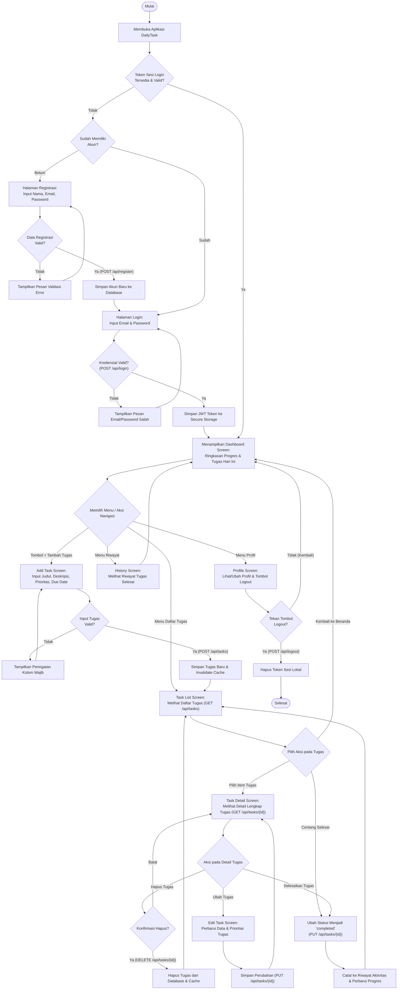
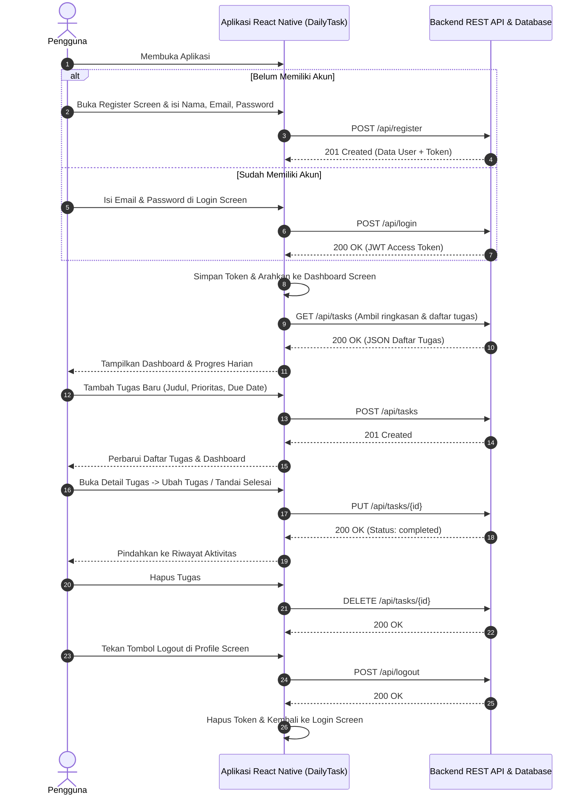

# PERANCANGAN FLOWCHART & ACTIVITY DIAGRAM – DAILYTASK

Dokumen ini memuat diagram alir penggunaan aplikasi **DailyTask – Aplikasi Manajemen Aktivitas Harian** secara menyeluruh, mulai dari pengguna membuka aplikasi, autentikasi (Login/Registrasi), melihat Dashboard, memilih menu, melihat daftar tugas, menambah tugas, mengubah tugas, menghapus tugas, menyelesaikan tugas, melihat riwayat aktivitas, hingga Logout.

---

## 1. Flowchart Keseluruhan Alur Penggunaan Aplikasi

---

## 2. Activity Diagram Swimlane (Pengguna vs Aplikasi React Native vs REST API Backend)

