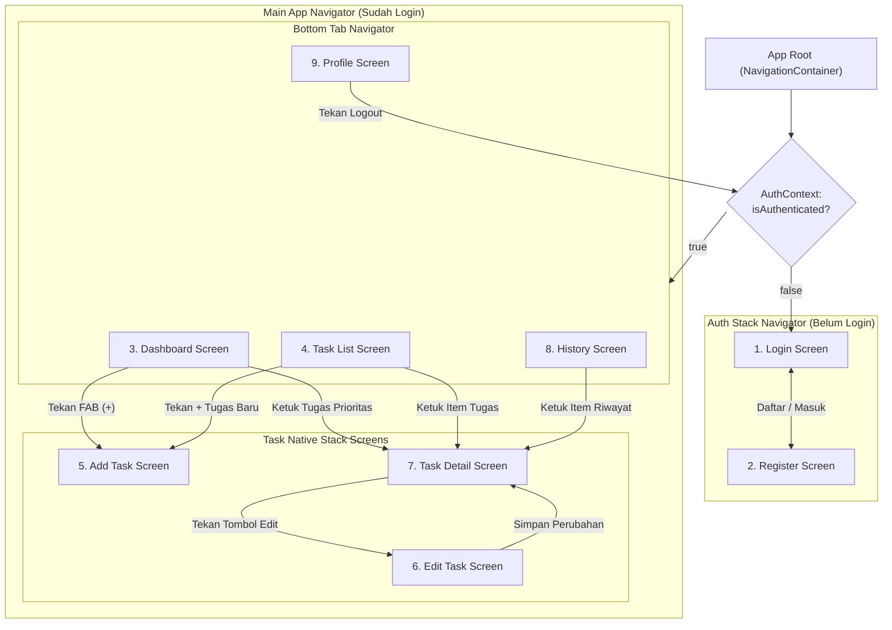

# PERANCANGAN NAVIGASI ANTARHALAMAN – DAILYTASK

Dokumen ini menjelaskan struktur navigasi antarhalaman pada aplikasi **DailyTask** yang mencakup 9 halaman wajib: **Login Screen**, **Register Screen**, **Dashboard Screen**, **Task List Screen**, **Add Task Screen**, **Edit Task Screen**, **Task Detail Screen**, **History Screen**, dan **Profile Screen**.

---

## 1. Diagram Pohon & Alur Navigasi Antarhalaman

---

## 2. Spesifikasi Fungsi dan Parameter Rute Setiap Halaman

| No | Nama Screen | Route Name | Parameter Navigasi (`route.params`) | Fungsi & Tanggung Jawab Halaman |
| :-: | :--- | :--- | :--- | :--- |
| 1 | **Login Screen** | `'Login'` | Tidak ada | Menerima input email & password, memanggil `POST /api/login`, dan menyimpan JWT token. |
| 2 | **Register Screen** | `'Register'` | Tidak ada | Menerima pendaftaran akun baru, memanggil `POST /api/register`, dan mengarahkan ke halaman Login/Dashboard. |
| 3 | **Dashboard Screen** | `'DashboardTab'` | Tidak ada | Menampilkan metrik produktivitas harian, bar persentase penyelesaian, dan daftar tugas mendesak hari ini. |
| 4 | **Task List Screen** | `'TaskListTab'` | `{ filterPriority?, filterStatus? }` | Menampilkan daftar seluruh tugas pengguna dengan pencarian kata kunci, filter prioritas, dan filter status. |
| 5 | **Add Task Screen** | `'AddTask'` | `{ defaultDate? }` | Menyediakan formulir input tugas baru (judul, deskripsi, prioritas, tenggat waktu) dan memanggil `POST /api/tasks`. |
| 6 | **Edit Task Screen** | `'EditTask'` | `{ taskId, initialTask }` | Menyediakan formulir pembaruan tugas yang sudah ada dan memanggil `PUT /api/tasks/{id}`. |
| 7 | **Task Detail Screen** | `'TaskDetail'` | `{ taskId }` | Menampilkan detail tugas secara lengkap serta menyediakan aksi **Tandai Selesai**, **Edit**, dan **Hapus**. |
| 8 | **History Screen** | `'HistoryTab'` | Tidak ada | Menampilkan daftar arsip dan timeline tugas yang telah diselesaikan (`status = 'completed'`). |
| 9 | **Profile Screen** | `'ProfileTab'` | Tidak ada | Menampilkan identitas pengguna, statistik penyelesaian, form ubah profil (`PUT /api/profile`), dan tombol **Logout**. |

