# LAPORAN UJIAN TENGAH SEMESTER (UTS)
## MATA KULIAH: PEMROGRAMAN MOBILE LANJUT (412573401)

---

### HALAMAN JUDUL

| Informasi Dokumen | Keterangan |
| :--- | :--- |
| **Judul Laporan** | **Pengerjaan Lengkap Ujian Tengah Semester (UTS) Pemrograman Mobile Lanjut: Analisis Arsitektur E-Commerce, Implementasi Aplikasi *RecipeKu* dengan TanStack Query, dan Perancangan Proyek *DailyTask*** |
| **Kode & Nama Mata Kuliah** | 412573401 – Pemrograman Mobile Lanjut (3 SKS) |
| **Program Studi** | Teknik Informatika |
| **Fakultas** | Fakultas Teknik dan Informatika |
| **Perguruan Tinggi** | Universitas Dian Nusantara (UNDIRA) |
| **Dosen Pengampu** | Sahrial Ihsani Ishak, S.Kom., M.Kom |
| **Tahun Akademik** | Ganjil 2026/2027 |
| **Hari / Tanggal Ujian** | Sabtu, 14 November 2026 |
| **Sifat Ujian** | *Case Based Learning* & *Project Based Learning* |

---

## BAB I: PENDAHULUAN

### 1.1. Latar Belakang
Pengembangan aplikasi perangkat bergerak (*mobile application development*) modern menuntut penguasaan yang menyeluruh atas arsitektur berlapis, manajemen *state* lokal maupun *server*, integrasi layanan web berbasis REST API, serta perancangan pengalaman pengguna (*UI/UX*) yang responsif. Kerangka kerja **React Native** memungkinkan pengembang membangun aplikasi *cross-platform* (Android dan iOS) menggunakan bahasa JavaScript dengan performa mendekati aplikasi asli (*native*).

Melalui Ujian Tengah Semester (UTS) mata kuliah **Pemrograman Mobile Lanjut** ini, seluruh Capaian Pembelajaran Mata Kuliah (CPMK 1, CPMK 2, dan CPMK 5) diuji melalui tiga bagian terintegrasi:
1. **Soal 1 (Bobot 20% – CPMK 1):** Analisis konsep arsitektur React Native, perbedaan *Local State* dan *Server State*, peran Context API/Redux, integrasi REST API (`GET`, `POST`, `PUT`, `DELETE`) dengan format JSON, serta mekanisme *Server State Management* pada kasus aplikasi *e-commerce*.
2. **Soal 2 (Bobot 35% – CPMK 2):** Implementasi nyata aplikasi eksplorasi resep masakan bernama **RecipeKu – Indonesian Recipe Explorer** yang terinspirasi dari Cookpad menggunakan **React Native (Expo)**, **Axios**, **React Navigation**, dan **TanStack Query** dengan sumber data **REST API DummyJSON Recipes**.
3. **Soal 3 (Bobot 45% – CPMK 5):** Perancangan proyek aplikasi mobile **DailyTask – Aplikasi Manajemen Aktivitas Harian** yang mencakup identifikasi masalah dan solusi, analisis kebutuhan fungsional dan nonfungsional, *flowchart/activity diagram*, rancangan navigasi, *wireframe* visual 9 halaman, arsitektur React Native, perancangan database & ERD, serta perancangan kontrak REST API.

### 1.2. Tujuan Pengerjaan
1. Menjelaskan secara sistematis bagaimana arsitektur React Native mengatur interaksi antara *UI Layer*, *Logic Layer*, *Data Layer*, dan *REST API* pada skenario aplikasi *e-commerce*.
2. Membangun aplikasi mobile **RecipeKu** yang berfungsi penuh, terstruktur, dan teruji dengan fitur daftar resep, pencarian nama resep ber-*debounce*, pencarian bahan makanan, detail resep lengkap, serta pengelolaan *caching*, *loading*, dan *error handling* berbasis **TanStack Query**.
3. Menyusun dokumen rancangan rekayasa perangkat lunak aplikasi mobile **DailyTask** yang lengkap, realistis, dan siap dijadikan acuan implementasi kolaboratif.

---

## BAB II: PEMBAHASAN SOAL 1 – ANALISIS ARSITEKTUR REACT NATIVE & KASUS E-COMMERCE (BOBOT 20%)

*(Dokumen lengkap pembahasan Soal 1 juga tersedia secara terpisah pada [`../01_SOAL_1/Jawaban_Soal_1.md`](file:///c:/Users/User/OneDrive/Documents/UTS%20Mobile/UTS_PEMROGRAMAN_MOBILE_LANJUT/01_SOAL_1/Jawaban_Soal_1.md)).*

### 2.1. Arsitektur React Native pada Kasus Daftar Produk E-Commerce
Aplikasi *e-commerce* React Native membagi tanggung jawab ke dalam tiga lapisan utama:
1. **UI Layer (*Presentation Layer*):** Merender komponen visual inti React Native seperti `View`, `Text`, `Image`, `TextInput`, `Pressable`, dan `FlatList`. Komponen `FlatList` sangat krusial pada katalog produk karena menerapkan *virtualization/windowing* sehingga hanya merender produk yang berada di area pandang layar (*viewport*).
2. **Logic Layer (*Business Logic & State Management Layer*):** Mengelola aturan bisnis, *custom hooks* (`useProducts`, `useCart`), pengelolaan *Server State* (**TanStack Query**), serta *Global Client State* (**Context API** atau **Redux Toolkit**).
3. **Data Layer (*Service & Network Layer*):** Mengabstraksi pemanggilan jaringan menggunakan **Axios** (`productApi.js`) menuju endpoint REST API dan penyimpanan lokal (`AsyncStorage`).

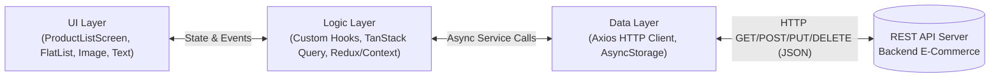

**Alur Pengambilan dan Penampilan Data Produk:**
1. Pengguna membuka `ProductListScreen`, memicu pemanggilan *hook* `useProducts()`.
2. *Logic Layer* memeriksa apakah data untuk `queryKey: ['products']` tersedia di memori *cache*. Jika belum ada, status `isLoading: true` dikirim ke *UI Layer* untuk menampilkan `ActivityIndicator` / *Skeleton*.
3. *Data Layer* mengirimkan permintaan asinkron `GET /api/v1/products` ke server REST API.
4. Server mengembalikan respons berstatus `200 OK` dengan payload **JSON** daftar produk.
5. *Data Layer* mendeserialisasi JSON menjadi Array objek JavaScript dan menyerahkannya ke *Logic Layer* untuk disimpan ke dalam *cache*.
6. *UI Layer* menerima data produk terbaru dan merendernya melalui `FlatList` ke layar pengguna.

---

### 2.2. Perbedaan Local State dan Server State serta Peran Context API / Redux

| Dimensi Perbandingan | Local State (*Client State*) | Server State (*Remote State*) |
| :--- | :--- | :--- |
| **Sumber Kebenaran (*Source of Truth*)** | Memori lokal aplikasi di perangkat pengguna. | Database pada *server backend* melalui REST API. |
| **Sifat Operasi** | Sinkron (*synchronous*) dan instan tanpa jeda jaringan. | Asinkron (*asynchronous*), memiliki siklus *loading*, *success*, dan *error*. |
| **Kepemilikan & Perubahan Data** | Hanya diubah oleh interaksi pengguna pada perangkat tersebut. | Dibagikan ke banyak pengguna; stok atau harga dapat berubah di server kapan saja. |
| **Contoh pada E-Commerce** | Pilihan varian warna/ukuran sebelum beli, teks input pencarian, status buka/tutup modal filter, tab aktif. | Katalog produk, detail harga & diskon, jumlah stok barang di gudang, riwayat pesanan. |

**Peran Context API dan Redux dalam Pengelolaan Keranjang Belanja (*Shopping Cart*):**
* Data keranjang belanja dibutuhkan secara global oleh banyak komponen (`HeaderCartBadge`, `ProductDetailScreen`, `CartScreen`, `CheckoutScreen`).
* **Context API** atau **Redux Toolkit** mencegah masalah *prop drilling* dengan menyediakan *centralized store* di sisi *client*.
* Pada saat pengguna menekan tombol **"+ Keranjang"**, Redux/Context memperbarui tampilan jumlah item di ikon keranjang secara instan (*Optimistic Update*), sementara modul layanan API melakukan sinkronisasi ke server melalui `POST /api/v1/cart/items`.

---

### 2.3. Integrasi REST API (`GET`, `POST`, `PUT`, `DELETE`) dan Format JSON

**JSON (*JavaScript Object Notation*)** berperan sebagai format standar pertukaran data yang ringan antara aplikasi React Native dan server. Objek JavaScript diserialisasi menggunakan `JSON.stringify()` saat dikirim pada *request body* (`Content-Type: application/json`) dan dideserialisasi menggunakan `JSON.parse()` saat diterima dari *response body*.

1. **`GET /api/v1/products` (Mengambil Daftar Produk):**
   * **Response JSON (`200 OK`):**
     ```json
     {
       "status": "success",
       "data": [
         {
           "id": "PRD-1001",
           "name": "Smartphone Nusantara Pro 5G",
           "price": 5849100,
           "stock": 15,
           "rating": 4.9
         }
       ]
     }
     ```
2. **`POST /api/v1/cart/items` (Menambahkan Produk ke Keranjang):**
   * **Request Body JSON:**
     ```json
     {
       "productId": "PRD-1001",
       "quantity": 1,
       "variant": { "color": "Midnight Black" }
     }
     ```
   * **Response JSON (`201 Created`):**
     ```json
     {
       "status": "success",
       "message": "Produk berhasil ditambahkan ke keranjang",
       "data": { "cartItemId": "CART-8821", "productId": "PRD-1001", "quantity": 1, "subtotal": 5849100 }
     }
     ```
3. **`PUT /api/v1/cart/items/CART-8821` (Memperbarui Jumlah Produk di Keranjang):**
   * **Request Body JSON:**
     ```json
     { "quantity": 3 }
     ```
   * **Response JSON (`200 OK`):**
     ```json
     {
       "status": "success",
       "message": "Jumlah produk berhasil diperbarui",
       "data": { "cartItemId": "CART-8821", "quantity": 3, "subtotal": 17547300 }
     }
     ```
4. **`DELETE /api/v1/cart/items/CART-8821` (Menghapus Produk dari Keranjang):**
   * **Response JSON (`200 OK`):**
     ```json
     {
       "status": "success",
       "message": "Produk berhasil dihapus dari keranjang",
       "data": { "deletedCartItemId": "CART-8821" }
     }
     ```

---

### 2.4. Server State Management dan Pengalaman Pengguna (UX) saat Koneksi Lambat/Terputus
1. **Caching:** Menyimpan respons API di memori berdasarkan `queryKey`. Ketika pengguna berpindah halaman lalu kembali ke katalog produk, data langsung ditampilkan dari *cache* dalam 0 ms tanpa memicu *loading spinner* berulang, serta memungkinkan produk yang pernah dibuka tetap terlihat meskipun koneksi tiba-tiba terputus.
2. **Refetching:** Menyegarkan data yang sudah melewati batas `staleTime` di latar belakang (*Stale-While-Revalidate*) atau saat jaringan kembali pulih (`refetchOnReconnect`), sehingga informasi harga dan stok selalu akurat tanpa mengganggu interaksi pengguna.
3. **Loading:** Menampilkan *Skeleton Loader* atau `ActivityIndicator` saat pengambilan data awal (*hard loading*) agar pengguna mengetahui aplikasi sedang memproses permintaan pada jaringan yang lambat dan tidak mengira aplikasi membeku (*freeze*).
4. **Error Handling:** Menangkap kegagalan jaringan atau *timeout*, melakukan *automatic retry* dengan jeda bertahap, serta menampilkan komponen *Error State* yang ramah pengguna lengkap dengan tombol **"Coba Lagi" (*Retry*)** sehingga aplikasi tidak pernah menampilkan layar putih kosong (*blank screen*).

---

## BAB III: IMPLEMENTASI SOAL 2 – APLIKASI RECIPEKU (BOBOT 35%)

### 3.1. Gambaran Umum dan Struktur Proyek RecipeKu
Aplikasi **RecipeKu – Indonesian Recipe Explorer** dibangun menggunakan **React Native (`0.76.7`)**, **Expo SDK 52**, **Axios**, **TanStack Query v5 (`@tanstack/react-query`)**, dan **React Navigation v7**. Kode sumber lengkap berada pada direktori [`../02_SOAL_2_RECIPEKU/source-code/`](file:///c:/Users/User/OneDrive/Documents/UTS%20Mobile/UTS_PEMROGRAMAN_MOBILE_LANJUT/02_SOAL_2_RECIPEKU/source-code).

```text
RecipeKu/ (02_SOAL_2_RECIPEKU/source-code/)
├── src/
│   ├── api/
│   │   └── recipeApi.js                  # Instance Axios & fungsi endpoint DummyJSON Recipes
│   ├── components/
│   │   ├── RecipeCard.js                 # Kartu resep reusable (Gambar, Cuisine, Rating, Waktu)
│   │   ├── SearchBar.js                  # Input pencarian reusable + tombol hapus (✕)
│   │   ├── Loading.js                    # Indikator loading + skeleton card preview
│   │   ├── ErrorState.js                 # Tampilan gagal jaringan + tombol Retry
│   │   └── EmptyState.js                 # Tampilan data kosong / pencarian tidak ditemukan
│   ├── screens/
│   │   ├── HomeScreen.js                 # Katalog resep FlatList + filter tag + status cache
│   │   ├── SearchScreen.js               # Pencarian nama resep (/recipes/search?q=) + debounce
│   │   ├── DetailScreen.js               # Detail resep (/recipes/{id}), bahan, & instruksi
│   │   ├── IngredientsScreen.js          # Pencarian resep berdasarkan multi-bahan makanan
│   │   └── CookingInstructionsScreen.js  # Mode panduan memasak langkah demi langkah
│   ├── navigation/
│   │   └── AppNavigator.js               # BottomTabNavigator & NativeStackNavigator
│   ├── hooks/
│   │   └── useRecipes.js                 # Custom hooks TanStack Query (staleTime, gcTime, enabled)
│   ├── constants/
│   │   └── colors.js                     # Palet warna natural hijau kuliner
│   └── utils/
│       ├── useDebounce.js                # Custom hook debounce 450ms
│       └── formatters.js                 # Helper pemformat waktu & deskripsi
├── App.js                                # QueryClient & QueryClientProvider
├── package.json
└── README.md
```

### 3.2. Implementasi Fitur Utama & TanStack Query
1. **Konfigurasi `QueryClient` (`App.js` & `useRecipes.js`):**
   * Menggunakan `staleTime: 300000` (5 menit) dan `gcTime: 1800000` (30 menit).
   * Menggunakan struktur `queryKey` konsisten: `['recipes', 'list', tag]`, `['recipes', 'search', query]`, dan `['recipes', 'detail', id]`.
   * Memanfaatkan `initialData` dari cache daftar resep ketika pengguna membuka `DetailScreen` sehingga tampilan detail terbuka secara instan.
2. **Pencarian Nama dengan Debounce (`SearchScreen.js`):**
   * Menggunakan `useDebounce(searchText, 450)` dan `enabled: normalizedQuery.length > 0` untuk memanggil `GET https://dummyjson.com/recipes/search?q={query}`.
3. **Pencarian Berdasarkan Bahan Makanan (`IngredientsScreen.js`):**
   * Karena API DummyJSON tidak menyediakan endpoint pencarian bahan di sisi server, `useRecipesByIngredients` memanfaatkan data `GET https://dummyjson.com/recipes?limit=50` yang disimpan di cache TanStack Query dan melakukan pencocokan multi-bahan terhadap array `recipe.ingredients`.

### 3.3. Tangkapan Layar (*Screenshots*) Aplikasi RecipeKu yang Berjalan

Seluruh tangkapan layar asli hasil eksekusi aplikasi **RecipeKu** tersimpan pada direktori [`../02_SOAL_2_RECIPEKU/screenshots/`](file:///c:/Users/User/OneDrive/Documents/UTS%20Mobile/UTS_PEMROGRAMAN_MOBILE_LANJUT/02_SOAL_2_RECIPEKU/screenshots):

| Tangkapan Layar | Deskripsi Tampilan |
| :---: | :--- |
| 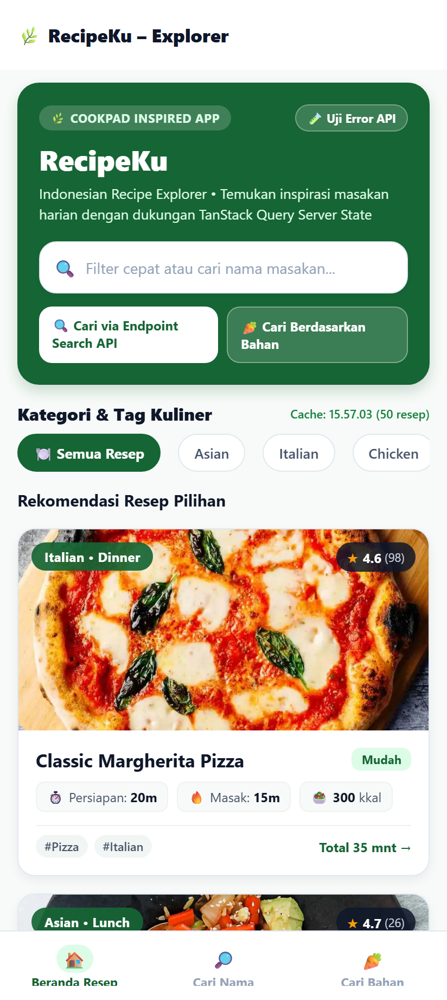 | **1. Home Screen (`HomeScreen.js`)**<br/>Menampilkan *Header Banner* **RecipeKu**, *Search Bar*, chip kategori/tag kuliner, informasi waktu *Cache* TanStack Query, serta daftar resep (`FlatList`) lengkap dengan gambar makanan, *cuisine*, *rating*, waktu persiapan, dan waktu memasak. |
| 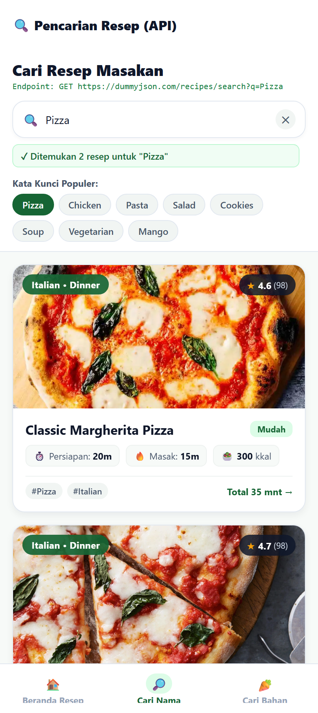 | **2. Search Recipe Screen – Kata Kunci "Pizza" (`SearchScreen.js`)**<br/>Menampilkan hasil pencarian dari endpoint `GET https://dummyjson.com/recipes/search?q=Pizza` dengan *Debounce* 450ms dan tombol hapus pencarian (`✕`). |
| 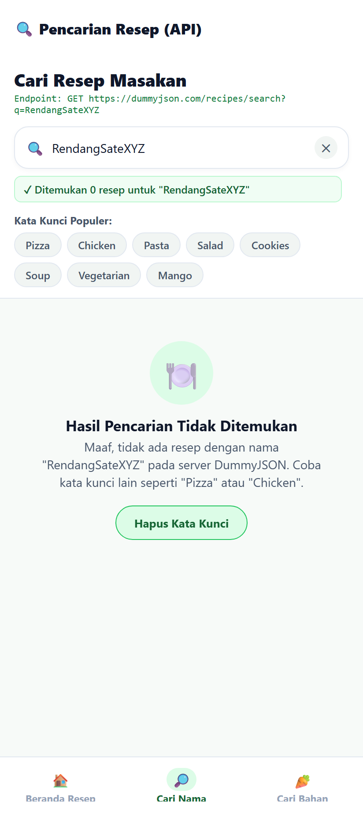 | **3. Search Empty State (`EmptyState.js`)**<br/>Tampilan ketika kata kunci pencarian tidak ditemukan pada server DummyJSON, dilengkapi tombol **"Hapus Kata Kunci"**. |
| 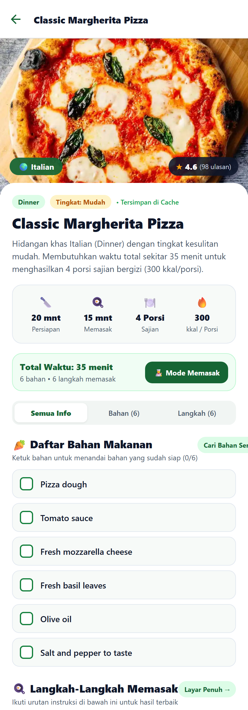 | **4. Recipe Detail Screen (`DetailScreen.js`)**<br/>Menampilkan gambar makanan, nama hidangan, deskripsi, *cuisine*, *rating*, waktu persiapan, waktu memasak, porsi, kalori, daftar bahan dengan fitur ceklis interaktif, dan langkah-langkah memasak (`GET /recipes/1`). |
| 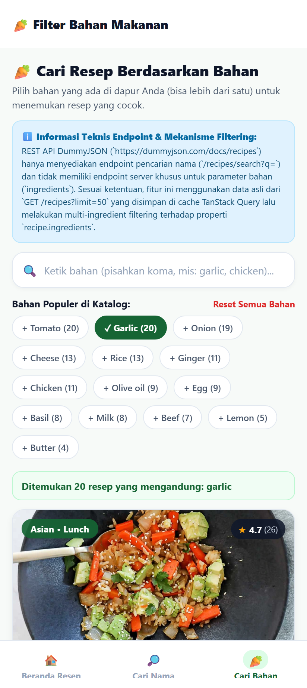 | **5. Search by Ingredients Screen (`IngredientsScreen.js`)**<br/>Menampilkan fitur pencarian berdasarkan bahan makanan (contoh: bahan `"Garlic"`), catatan penjelasan teknis endpoint API, serta highlight bahan yang cocok pada setiap kartu resep. |
| 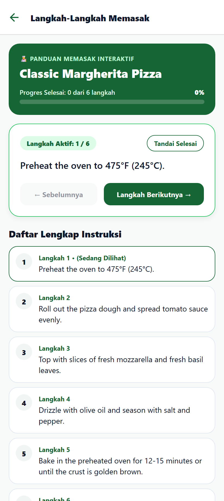 | **6. Interactive Cooking Instructions (`CookingInstructionsScreen.js`)**<br/>Halaman panduan memasak langkah demi langkah lengkap dengan indikator persentase penyelesaian langkah memasak. |
| 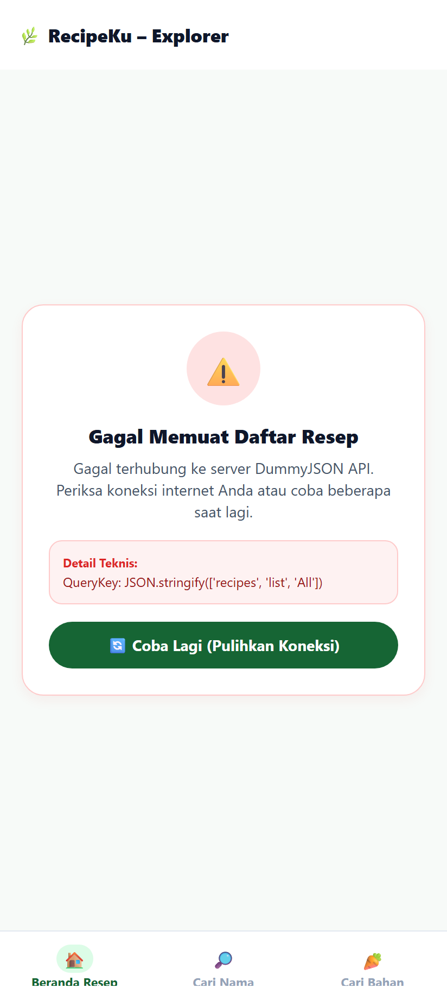 | **7. Error Handling & Tombol Retry (`ErrorState.js`)**<br/>Tampilan khusus ketika terjadi kegagalan koneksi API lengkap dengan detail teknis `QueryKey` dan tombol **"🔄 Coba Lagi (Pulihkan Koneksi)"**. |

---

## BAB IV: PENGUJIAN DAN QUALITY ASSURANCE (QA) APLIKASI RECIPEKU

Pengujian dilakukan terhadap seluruh fitur wajib aplikasi **RecipeKu**. Rincian lengkap skenario dan log pengujian tersimpan pada [`../02_SOAL_2_RECIPEKU/dokumentasi/Hasil_Pengujian_QA_RecipeKu.md`](file:///c:/Users/User/OneDrive/Documents/UTS%20Mobile/UTS_PEMROGRAMAN_MOBILE_LANJUT/02_SOAL_2_RECIPEKU/dokumentasi/Hasil_Pengujian_QA_RecipeKu.md).

| No | Fitur | Skenario | Hasil yang Diharapkan | Status |
| :-: | :--- | :--- | :--- | :---: |
| 1 | **Pembukaan Aplikasi** | Menjalankan aplikasi RecipeKu dari `App.js`. | Aplikasi terbuka tanpa error dan menampilkan `HomeScreen`. | **PASS** |
| 2 | **Pengambilan Daftar Resep** | Mengambil katalog resep dari `GET /recipes?limit=50`. | 50 resep berhasil diambil dan dirender di `FlatList`. | **PASS** |
| 3 | **Pemuatan Gambar Resep** | Memuat gambar makanan dari URL CDN DummyJSON. | Seluruh gambar makanan tampil proporsional di `RecipeCard` & `DetailScreen`. | **PASS** |
| 4 | **Pencarian Nama Berhasil** | Mencari kata kunci `"Pizza"` pada `SearchScreen` (`GET /recipes/search?q=Pizza`). | Menampilkan 2 resep Pizza setelah *debounce* 450ms. | **PASS** |
| 5 | **Pencarian Tanpa Hasil** | Mencari kata kunci `"RendangSateXYZ"` yang tidak ada di API. | Menampilkan komponen `EmptyState` beserta tombol reset pencarian. | **PASS** |
| 6 | **Pembukaan Detail Resep** | Memilih kartu resep *Classic Margherita Pizza* (`GET /recipes/1`). | Halaman detail tampil memuat metadata waktu, porsi, kalori, dan *rating*. | **PASS** |
| 7 | **Daftar Bahan Makanan** | Memeriksa daftar bahan pada `DetailScreen` dan mengetuk checkbox bahan. | 6 bahan makanan tampil lengkap dan dapat dicentang. | **PASS** |
| 8 | **Langkah-Langkah Memasak** | Memeriksa instruksi memasak di `DetailScreen` & `CookingInstructionsScreen`. | 6 langkah memasak tampil berurutan lengkap dengan navigasi langkah. | **PASS** |
| 9 | **Pencarian Berdasarkan Bahan** | Memilih bahan `"Garlic"` pada `IngredientsScreen`. | Menampilkan resep yang mengandung *Garlic* beserta daftar bahan yang cocok. | **PASS** |
| 10 | **Tampilan Loading** | Mengamati tampilan saat pengambilan data awal (*initial loading*). | Komponen `Loading` tampil dengan spinner dan *skeleton preview*. | **PASS** |
| 11 | **Error Handling** | Menguji kegagalan pemanggilan API (mode simulasi error jaringan). | Komponen `ErrorState` tampil rapi tanpa menyebabkan aplikasi *crash*. | **PASS** |
| 12 | **Tombol Retry** | Menekan tombol **"Coba Lagi"** pada layar `ErrorState`. | Aplikasi memanggil ulang API (`refetch`) dan memulihkan daftar resep. | **PASS** |
| 13 | **Caching TanStack Query** | Bernavigasi dari Home ke Detail lalu kembali ke Home dalam waktu < 5 menit. | Data langsung disajikan dari memori *cache* tanpa pemanggilan ulang API. | **PASS** |

---

## BAB V: PERANCANGAN SOAL 3 – PROYEK APLIKASI MOBILE DAILYTASK (BOBOT 45%)

*(Dokumen lengkap perancangan Soal 3 beserta file diagram terpisah tersedia pada [`../03_SOAL_3_DAILYTASK/dokumen-rancangan.md`](file:///c:/Users/User/OneDrive/Documents/UTS%20Mobile/UTS_PEMROGRAMAN_MOBILE_LANJUT/03_SOAL_3_DAILYTASK/dokumen-rancangan.md)).*

### 5.1. Identifikasi Masalah, Solusi, dan Target Pengguna
* **Nama Proyek:** **DailyTask – Aplikasi Manajemen Aktivitas Harian**
* **Permasalahan Utama:** Pencatatan tugas harian yang tersebar dan tidak terstruktur, kesulitan menentukan skala prioritas tugas yang mendesak, kurangnya visibilitas progres penyelesaian harian, serta ketiadaan rekam jejak riwayat produktivitas.
* **Solusi & Tujuan:** Menyediakan aplikasi mobile berbasis React Native dengan fitur pencatatan tugas (*CRUD*), pengelompokan prioritas (*High*, *Medium*, *Low*), pengingat tenggat waktu (`due_date`), *Dashboard* persentase progres harian, serta pencatatan riwayat aktivitas yang tersinkronisasi melalui REST API.
* **Target Pengguna:** Mahasiswa, Pekerja Profesional, dan Masyarakat Umum.

### 5.2. Ringkasan Kebutuhan Fungsional & Nonfungsional
* **11 Kebutuhan Fungsional:** Registrasi (`FR-01`), Login (`FR-02`), Logout (`FR-03`), Melihat Dashboard (`FR-04`), Menambahkan Tugas (`FR-05`), Mengubah Tugas (`FR-06`), Menghapus Tugas (`FR-07`), Melihat Detail Tugas (`FR-08`), Mengatur Prioritas Tugas (`FR-09`), Mengubah Status Tugas Menjadi Selesai (`FR-10`), dan Melihat Riwayat Aktivitas (`FR-11`).
* **6 Kebutuhan Nonfungsional:** Kemudahan Penggunaan/*Usability* (`NFR-01`), Keamanan/JWT & Bcrypt (`NFR-02`), Performa 60 FPS & Caching (`NFR-03`), Responsivitas Multi-Layar (`NFR-04`), Keandalan Offline/Error Recovery (`NFR-05`), dan Kemudahan Pemeliharaan Kode Modular (`NFR-06`).

### 5.3. Flowchart dan Navigasi Antarhalaman DailyTask
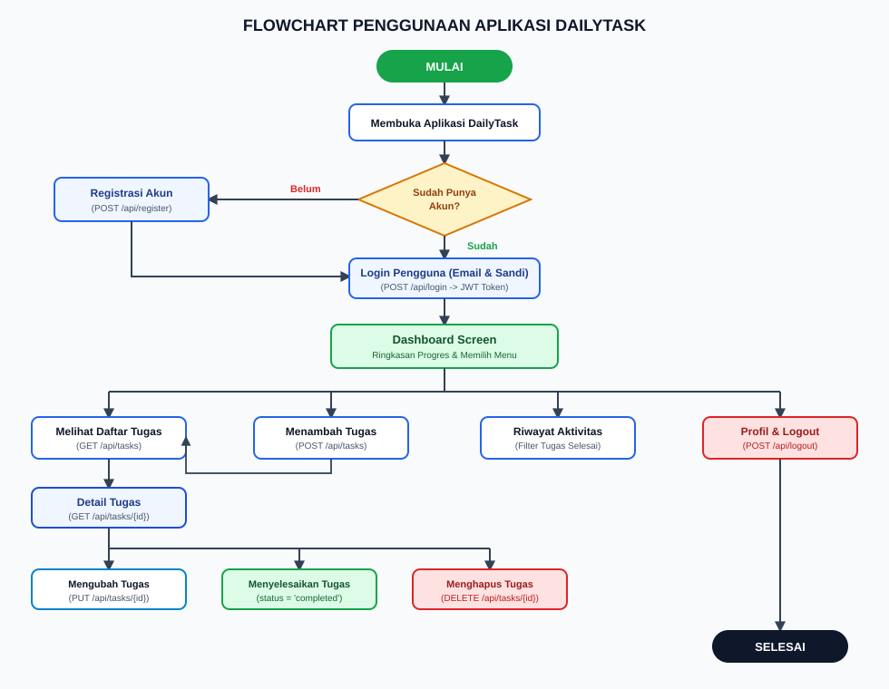

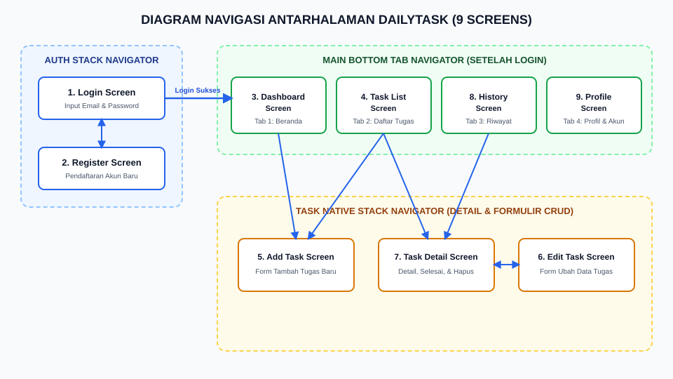

### 5.4. Wireframe UI/UX 9 Halaman Smartphone DailyTask
Rancangan visual untuk seluruh 9 halaman (**Login**, **Register**, **Dashboard**, **Daftar Tugas**, **Tambah Tugas**, **Edit Tugas**, **Detail Tugas**, **Riwayat Aktivitas**, dan **Profil**) telah dibuat dalam ukuran layar *smartphone* dan dapat diperiksa pada [`../03_SOAL_3_DAILYTASK/wireframe/wireframe_dailytask.html`](file:///c:/Users/User/OneDrive/Documents/UTS%20Mobile/UTS_PEMROGRAMAN_MOBILE_LANJUT/03_SOAL_3_DAILYTASK/wireframe/wireframe_dailytask.html) serta file SVG individual `01_login.svg` s/d `09_profile.svg`.

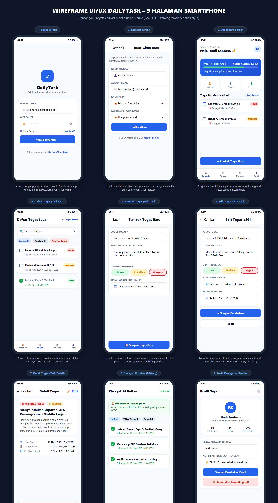

### 5.5. Arsitektur React Native, Database (ERD), dan Rancangan REST API
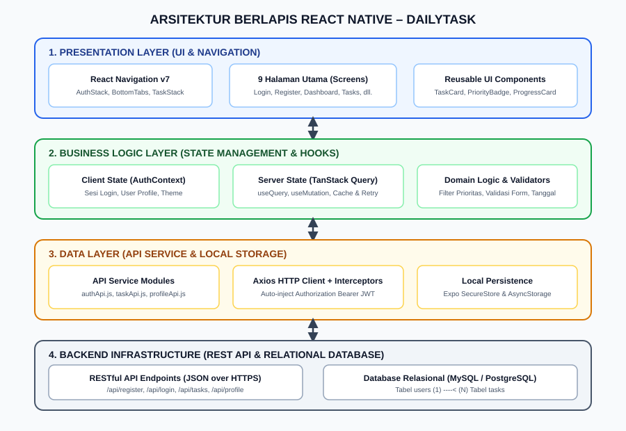

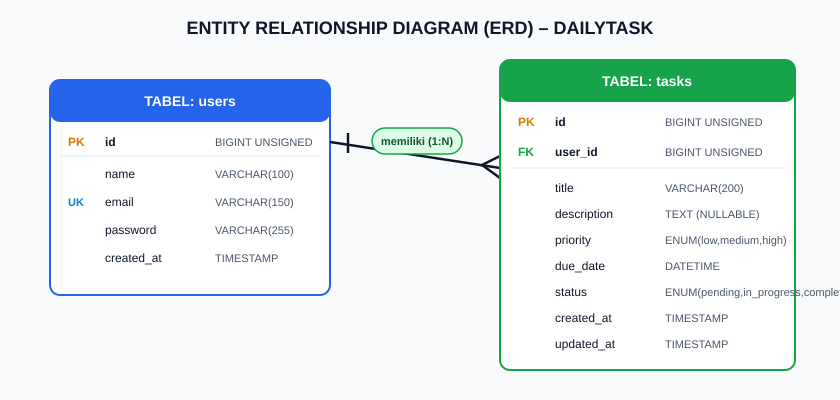

* **Relasi Database:** Tabel `users` (`id`, `name`, `email`, `password`, `created_at`) berelasi **One-to-Many (`1:N`)** dengan tabel `tasks` (`id`, `user_id`, `title`, `description`, `priority`, `due_date`, `status`, `created_at`, `updated_at`) melalui *Foreign Key* `tasks.user_id -> users.id`.
* **Rancangan 10 Endpoint REST API Backend:**
  * **Authentication:** `POST /api/register`, `POST /api/login`, `POST /api/logout`
  * **Tasks:** `GET /api/tasks`, `GET /api/tasks/{id}`, `POST /api/tasks`, `PUT /api/tasks/{id}`, `DELETE /api/tasks/{id}`
  * **Profile:** `GET /api/profile`, `PUT /api/profile`
  *(Catatan: Seluruh endpoint di atas merupakan rancangan arsitektur backend untuk proyek DailyTask, bukan API publik yang sudah tersedia).*

---

## BAB VI: KESIMPULAN

Berdasarkan seluruh rangkaian analisis, implementasi, pengujian, dan perancangan yang telah dilakukan pada Ujian Tengah Semester (UTS) Pemrograman Mobile Lanjut ini, dapat disimpulkan bahwa:
1. Penerapan arsitektur berlapis (*UI Layer*, *Logic Layer*, dan *Data Layer*) pada React Native memberikan pemisahan tanggung jawab yang bersih antara komponen visual (`FlatList`, `View`, `Text`, `Image`) dengan logika pengelolaan state dan komunikasi jaringan berbasis REST API JSON.
2. Pemisahan antara **Local/Client State** (menggunakan `useState`, Context API, atau Redux Toolkit) dan **Server State** (menggunakan **TanStack Query**) terbukti sangat efektif meningkatkan performa aplikasi *mobile*. Implementasi *caching* (`staleTime` & `gcTime`), *debounced search*, *loading indicator*, dan *error handling* dengan fitur *retry* pada aplikasi **RecipeKu** menghasilkan pengalaman pengguna (*UX*) yang cepat, hemat trafik jaringan, dan tangguh terhadap gangguan koneksi.
3. Perancangan proyek **DailyTask – Aplikasi Manajemen Aktivitas Harian** telah disusun secara komprehensif dari hulu ke hilir—mulai dari analisis kebutuhan fungsional/nonfungsional, *flowchart*, arsitektur navigasi 9 layar, *wireframe* visual proporsi *smartphone*, arsitektur kode React Native, skema database relasional (ERD), hingga spesifikasi kontrak REST API berbasis JWT.

