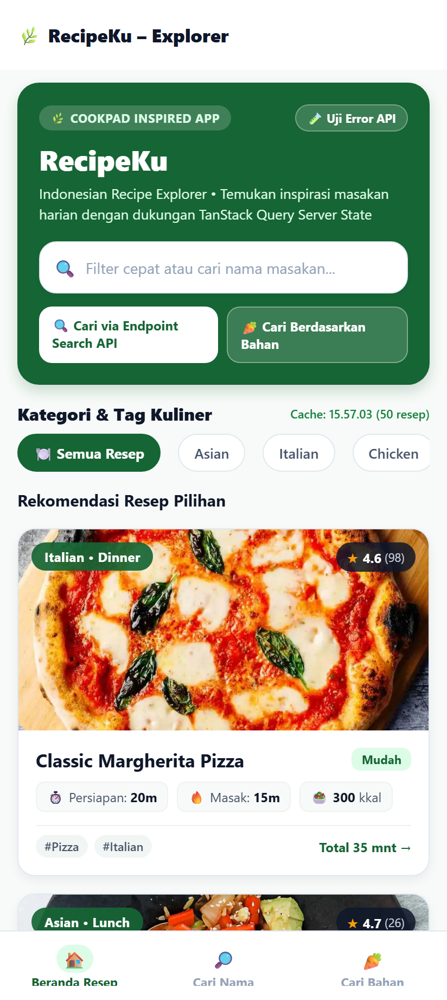
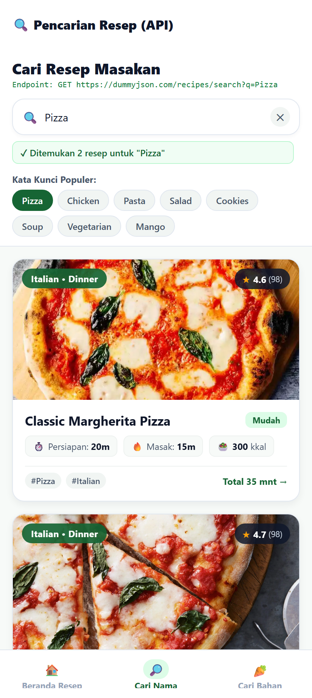
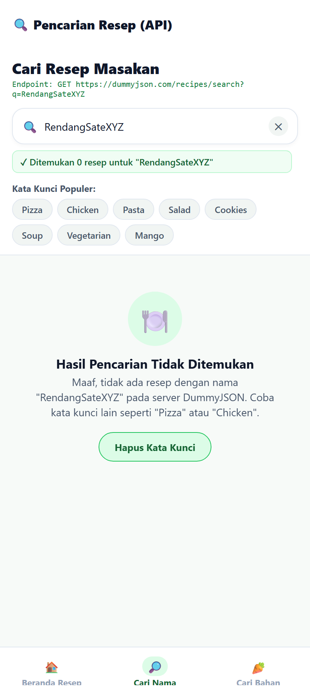
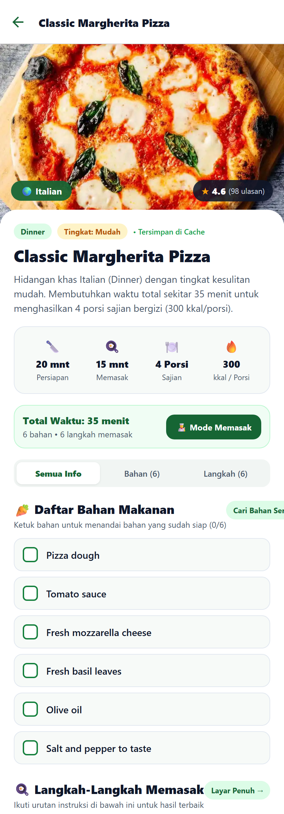
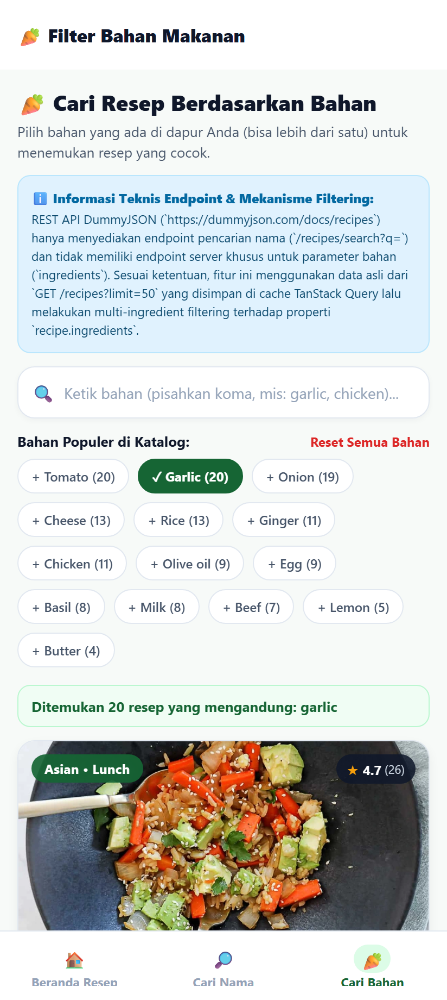
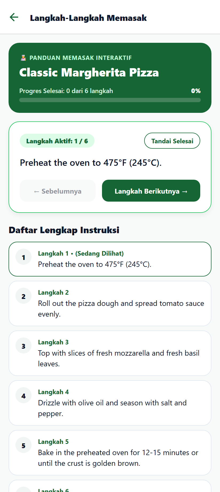
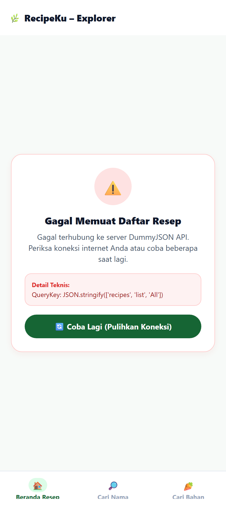

# UJIAN TENGAH SEMESTER (UTS) – PEMROGRAMAN MOBILE LANJUT

**Nama / NIM:** Marviel David (411231222)  
**Mata Kuliah:** 412573401 Pemrograman Mobile Lanjut (3 SKS)  
**Program Studi:** Teknik Informatika – Fakultas Teknik dan Informatika, Universitas Dian Nusantara  
**Dosen Pengampu:** Sahrial Ihsani Ishak, S.Kom., M.Kom  
**Tahun Akademik:** Ganjil 2026/2027  

---

## Struktur Direktori Pengumpulan UTS

Repositori ini disusun secara sistematis mengikuti instruksi dan rubrik penilaian UTS Pemrograman Mobile Lanjut untuk **Soal 1** dan **Soal 2**, lengkap dengan dokumentasi teknis dan pengujian Quality Assurance:

```text
UTS_PEMROGRAMAN_MOBILE_LANJUT/
│
├── 01_SOAL_1/
│   ├── Jawaban_Soal_1.md                 # Jawaban analisis arsitektur RN, State, REST API, & Server State
│   └── 01_Jawaban_Soal_1.md              # Salinan identik sesuai penamaan Bagian 2
│
├── 02_SOAL_2_RECIPEKU/
│   ├── source-code/                      # Proyek lengkap Expo React Native + TanStack Query
│   │   ├── src/
│   │   │   ├── api/recipeApi.js
│   │   │   ├── components/ (RecipeCard, SearchBar, Loading, ErrorState, EmptyState)
│   │   │   ├── screens/ (HomeScreen, SearchScreen, DetailScreen, IngredientsScreen, CookingInstructionsScreen)
│   │   │   ├── navigation/AppNavigator.js
│   │   │   ├── hooks/useRecipes.js
│   │   │   ├── constants/colors.js
│   │   │   └── utils/ (useDebounce.js, formatters.js)
│   │   ├── App.js
│   │   ├── package.json
│   │   └── README.md
│   ├── assets/                           # Aset visual aplikasi RecipeKu
│   ├── screenshots/                      # Tangkapan layar asli (screenshots) aplikasi RecipeKu yang berjalan
│   ├── dokumentasi/
│   │   ├── Dokumentasi_Teknis_RecipeKu.md
│   │   └── Hasil_Pengujian_QA_RecipeKu.md
│   └── README.md
│
└── README.md                             # Panduan utama repositori UTS
```

---

## Ringkasan Pengerjaan Setiap Bagian

### 1. Soal 1 – Analisis Konsep React Native & Kasus E-Commerce
* **Lokasi File:** [`01_SOAL_1/Jawaban_Soal_1.md`](file:///c:/Users/User/OneDrive/Documents/UTS%20Mobile/UTS_PEMROGRAMAN_MOBILE_LANJUT/01_SOAL_1/Jawaban_Soal_1.md)
* **Cakupan:**
  1. Arsitektur berlapis React Native (*UI Layer*, *Logic Layer*, *Data Layer*, komponen `FlatList`/`View`/`Text`/`Image`, dan alur pengambilan produk dari REST API).
  2. Perbedaan mendalam *Local State* vs *Server State* beserta tabel perbandingan, peran Context API & Redux Toolkit dalam manajemen keranjang belanja (*Shopping Cart*).
  3. Integrasi REST API menggunakan HTTP Method `GET`, `POST`, `PUT`, dan `DELETE` dengan contoh lengkap *Request* dan *Response* JSON.
  4. Manajemen *Server State* (*Caching*, *Refetching*, *Loading*, *Error Handling*) dan dampaknya terhadap kenyamanan pengguna (*UX*) saat jaringan lambat atau terputus.

### 2. Soal 2 – Aplikasi Resep Masakan: RecipeKu – Indonesian Recipe Explorer
* **Lokasi Kode Sumber:** [`02_SOAL_2_RECIPEKU/source-code/`](file:///c:/Users/User/OneDrive/Documents/UTS%20Mobile/UTS_PEMROGRAMAN_MOBILE_LANJUT/02_SOAL_2_RECIPEKU/source-code)
* **Cara Menjalankan:**
  ```bash
  cd "02_SOAL_2_RECIPEKU/source-code"
  npm install --legacy-peer-deps
  npx expo start --web
  ```
* **Fitur Utama:**
  * Katalog resep (`FlatList`), filter kategori/tag, dan indikator waktu *Cache* TanStack Query.
  * Pencarian resep berdasarkan nama makanan (`GET https://dummyjson.com/recipes/search?q=Pizza`) dengan *Debounce* 450ms, tombol *Clear*, dan *Empty State*.
  * Detail resep (`GET https://dummyjson.com/recipes/{id}`) menampilkan gambar, deskripsi, *cuisine*, *rating*, waktu persiapan & memasak, porsi, kalori, ceklis bahan makanan, dan langkah memasak.
  * Pencarian resep berdasarkan bahan makanan (*Search by Ingredients*) menggunakan *client-side multi-ingredient filtering* di atas *cached Server State* (`GET /recipes?limit=50`) disertai penjelasan transparan keterbatasan API DummyJSON.
  * Penanganan *Loading State*, *Error State* dengan tombol *Retry*, serta *Caching* (`staleTime: 5 menit`, `gcTime: 30 menit`).

---

## Dokumentasi Tangkapan Layar Aplikasi RecipeKu

Berikut adalah 7 tangkapan layar aktual dari aplikasi **RecipeKu – Indonesian Recipe Explorer** beserta penjelasan masing-masing fitur:

<table>
  <tr>
    <td align="center" width="50%">
      <br/>
      <strong>1. Home Screen</strong><br/>
      <sub>Menampilkan katalog 50 resep dari <code>GET /recipes?limit=50</code> menggunakan <code>FlatList</code>, filter kategori/tag kuliner, serta indikator status <em>cache</em> TanStack Query.</sub>
    </td>
    <td align="center" width="50%">
      <br/>
      <strong>2. Search Screen ("Pizza")</strong><br/>
      <sub>Pencarian resep berdasarkan nama makanan via <code>GET /recipes/search?q=Pizza</code> dengan mekanisme <em>debounce</em> 450 ms agar pemanggilan API lebih efisien.</sub>
    </td>
  </tr>
  <tr>
    <td align="center" width="50%">
      <br/>
      <strong>3. Empty Search State</strong><br/>
      <sub>Tampilan komponen <code>EmptyState.js</code> ketika kata kunci tidak ditemukan (contoh: <code>"RendangSateXYZ"</code>), lengkap dengan tombol <em>Hapus Kata Kunci</em>.</sub>
    </td>
    <td align="center" width="50%">
      <br/>
      <strong>4. Detail Screen</strong><br/>
      <sub>Menampilkan detail resep (<code>GET /recipes/{id}</code>) beserta <em>initial cache hydration</em>: gambar hero, waktu persiapan &amp; memasak, porsi, kalori, rating, serta ceklis bahan makanan.</sub>
    </td>
  </tr>
  <tr>
    <td align="center" width="50%">
      <br/>
      <strong>5. Search by Ingredients ("Garlic")</strong><br/>
      <sub>Filter multi-bahan di sisi <em>client</em> menggunakan <code>useMemo</code> terhadap properti <code>recipe.ingredients</code> dari data <em>cache</em> <code>GET /recipes?limit=50</code> (menemukan 20 resep mengandung <em>garlic</em>).</sub>
    </td>
    <td align="center" width="50%">
      <br/>
      <strong>6. Cooking Instructions</strong><br/>
      <sub>Mode panduan memasak interaktif langkah demi langkah dengan navigasi <em>Sebelumnya/Berikutnya</em> serta pelacakan progres penyelesaian.</sub>
    </td>
  </tr>
  <tr>
    <td align="center" colspan="2">
      <br/>
      <strong>7. Error Handling &amp; Retry State</strong><br/>
      <sub>Tampilan komponen <code>ErrorState.js</code> saat simulasi gangguan jaringan aktif, menampilkan detail teknis <code>QueryKey</code> dan tombol <em>Coba Lagi</em> untuk memanggil <code>refetch()</code> tanpa menyebabkan <em>crash</em>.</sub>
    </td>
  </tr>
</table>

